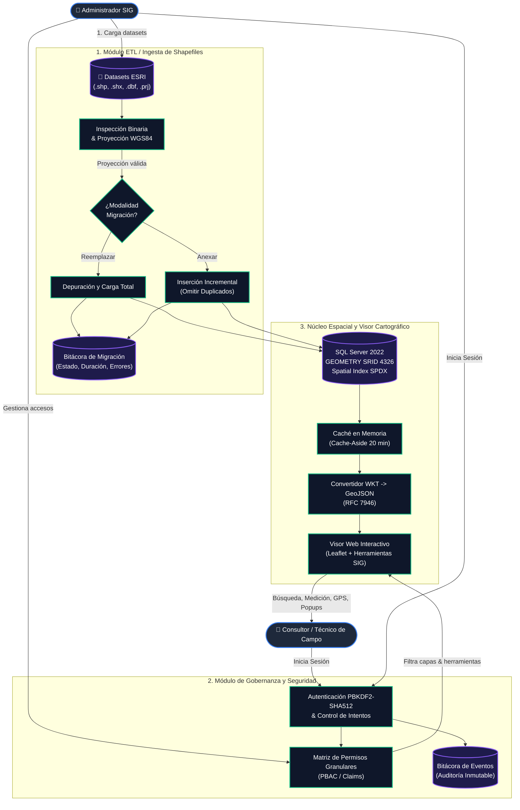
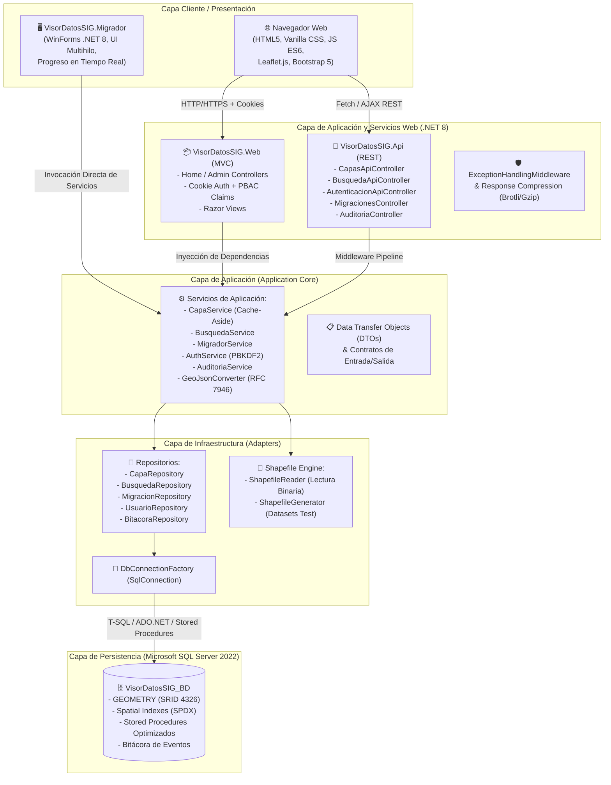
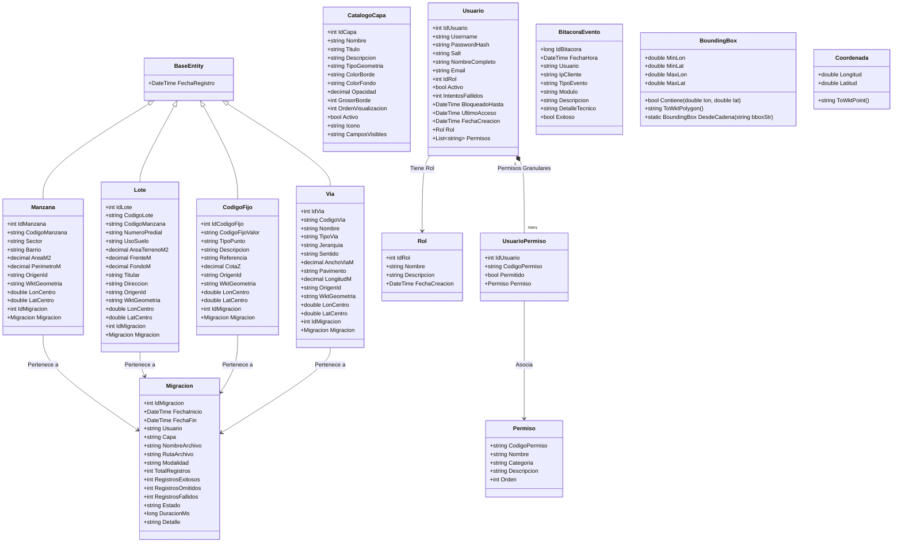
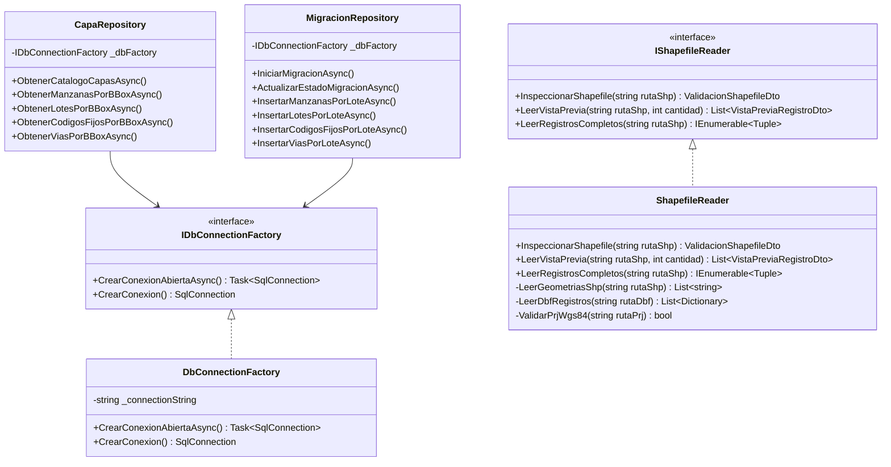
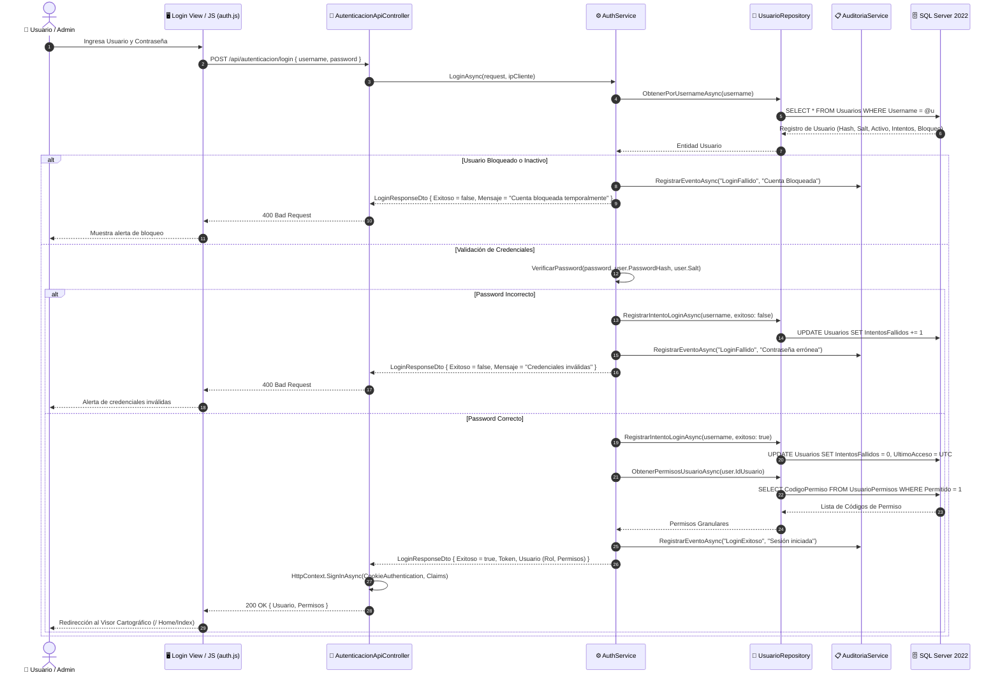
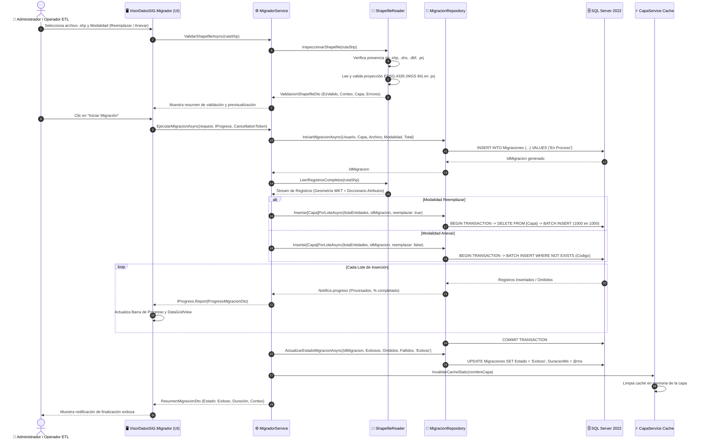
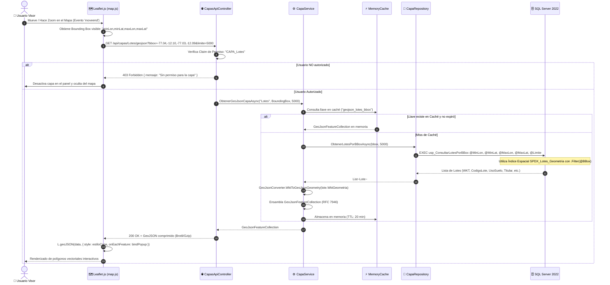
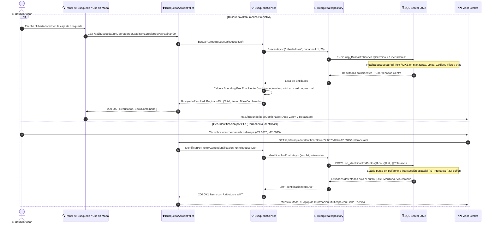
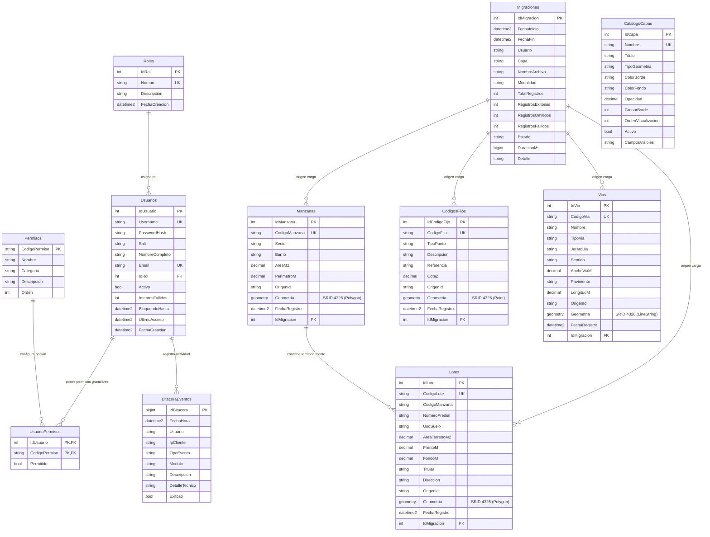

# 🌐 ARQUITECTURA DE SOFTWARE Y DOCUMENTACIÓN TÉCNICA
## Sistema de Información Geográfica Corporativo y Visor Cartográfico Territorial — **VisorDatosSIG 2026**

---

> **Autor:** Arquitecto de Software Principal  
> **Versión del Sistema:** v2026.1.0  
> **Fecha de Emisión:** Agosto 2026  
> **Sistema de Referencia Espacial:** EPSG:4326 (WGS 84 - Latitud/Longitud)  
> **Estándar Cartográfico:** RFC 7946 GeoJSON / OpenGIS Simple Features Specification  
> **Pila Tecnológica:** .NET 8 / C# 12, Microsoft SQL Server 2022 Spatial, ASP.NET Core MVC & RESTful API, Leaflet.js, Bootstrap 5  

---

## 📑 TABLA DE CONTENIDOS

1. [Resumen Ejecutivo y Visión General del Sistema](#1-resumen-ejecutivo-y-visión-general-del-sistema)
2. [Modelo de Negocio y Dominio Territorial](#2-modelo-de-negocio-y-dominio-territorial)
   - 2.1 [Descripción del Dominio](#21-descripción-del-dominio)
   - 2.2 [Diagrama del Modelo de Negocio y Flujo de Procesos (Mermaid)](#22-diagrama-del-modelo-de-negocio-y-flujo-de-procesos)
   - 2.3 [Capas Cartográficas y Atributos de Negocio](#23-capas-cartográficas-y-atributos-de-negocio)
3. [Arquitectura del Sistema y Patrones de Diseño](#3-arquitectura-del-sistema-y-patrones-de-diseño)
   - 3.1 [Enfoque Clean Architecture & N-Tier](#31-enfoque-clean-architecture--n-tier)
   - 3.2 [Diagrama de Arquitectura de Componentes y Despliegue](#32-diagrama-de-arquitectura-de-componentes-y-despliegue)
   - 3.3 [Patrones de Diseño Implementados](#33-patrones-de-diseño-implementados)
4. [Diagramas de Clases UML del Sistema](#4-diagramas-de-clases-uml-del-sistema)
   - 4.1 [Diagrama de Clases: Capa de Dominio y Entidades](#41-diagrama-de-clases-capa-de-dominio-y-entidades)
   - 4.2 [Diagrama de Clases: Capa de Aplicación e Interfaces](#42-diagrama-de-clases-capa-de-aplicación-e-interfaces)
   - 4.3 [Diagrama de Clases: Capa de Infraestructura y Parser Binario](#43-diagrama-de-clases-capa-de-infraestructura-y-parser-binario)
5. [Diagramas de Secuencia UML](#5-diagramas-de-secuencia-uml)
   - 5.1 [Secuencia: Autenticación de Usuario y Control PBAC](#51-secuencia-autenticación-de-usuario-y-control-pbac)
   - 5.2 [Secuencia: Ingesta Transaccional de Shapefiles (ETL)](#52-secuencia-ingesta-transaccional-de-shapefiles-etl)
   - 5.3 [Secuencia: Consulta Cartográfica Espacial con Bounding Box y Caché](#53-secuencia-consulta-cartográfica-espacial-con-bounding-box-y-caché)
   - 5.4 [Secuencia: Búsqueda Territorial y Geo-Identificación por Coordenadas](#54-secuencia-búsqueda-territorial-y-geo-identificación-por-coordenadas)
6. [Diagrama de Comunicación y Colaboración](#6-diagrama-de-comunicación-y-colaboración)
7. [Especificación de APIs y Protocolos de Comunicación](#7-especificación-de-apis-y-protocolos-de-comunicación)
   - 7.1 [Estrategia de Comunicación e Integración de Servicios](#71-estrategia-de-comunicación-e-integración-de-servicios)
   - 7.2 [Catálogo Integral de Endpoints RESTful](#72-catálogo-integral-de-endpoints-restful)
   - 7.3 [Contratos de Datos y Esquemas GeoJSON RFC 7946](#73-contratos-de-datos-y-esquemas-geojson-rfc-7946)
8. [Diseño de Base de Datos y Modelo Físico Espacial](#8-diseño-de-base-de-datos-y-modelo-físico-espacial)
   - 8.1 [Diagrama Entidad-Relación Espacial (ERD)](#81-diagrama-entidad-relación-espacial-erd)
   - 8.2 [Optimización de Índices Espaciales y Stored Procedures](#82-optimización-de-índices-espaciales-y-stored-procedures)
9. [Modelo de Seguridad, RBAC y Permisos Granulares (PBAC)](#9-modelo-de-seguridad-rbac-y-permisos-granulares-pbac)
   - 9.1 [Criptografía y Políticas de Autenticación](#91-criptografía-y-políticas-de-autenticación)
   - 9.2 [Matriz de Permisos y Feature Flags](#92-matriz-de-permisos-y-feature-flags)
   - 9.3 [Gobernanza y Bitácora de Auditoría Inmutable](#93-gobernanza-y-bitácora-de-auditoría-inmutable)
10. [Guía de Puesta en Marcha, Ejecución y Pruebas](#10-guía-de-puesta-en-marcha-ejecución-y-pruebas)

---

## 1. RESUMEN EJECUTIVO Y VISIÓN GENERAL DEL SISTEMA

**VisorDatosSIG 2026** es una plataforma corporativa integral de visualización, análisis, gestión catastral e ingesta de datos espaciales (GIS). Su arquitectura ha sido diseñada con estándares empresariales de alta disponibilidad, seguridad criptográfica avanzada, procesamiento geométrico nativo en base de datos y una experiencia de usuario interactiva y fluida.

```
+---------------------------------------------------------------------------------------+
|                                    VISORDATOSSIG 2026                                 |
+---------------------------------------------------------------------------------------+
|  [Desktop ETL WinForms]       [Web Portal & GIS Leaflet]        [Headless RESTful API]|
|            \                             |                             /              |
|             \                            |                            /               |
|              +---------------------------+---------------------------+                |
|                                          |                                            |
|                        [Core Domain & Clean Application Layer]                         |
|                                          |                                            |
|                  [Infrastructure: Spatial Parsers & Repositories]                     |
|                                          |                                            |
|             [SQL Server 2022 Spatial: GEOMETRY WGS84 + Spatial Indexes]               |
+---------------------------------------------------------------------------------------+
```

### Objetivos Clave de la Arquitectura
1. **Rendimiento Cartográfico Excepcional:** Renderizado dinámico sobre Leaflet.js con compresión de respuestas HTTP (Gzip/Brotli), soporte de consultas espaciales acotadas por *Bounding Box* (`BBox`) y un motor de caché en memoria (*Cache-Aside*) para minimizar la carga sobre el motor de base de datos.
2. **Independencia y Modularidad (Clean Architecture):** Separación estricta entre las capas de *Dominio*, *Aplicación*, *Infraestructura*, *API* y *Presentación Web/Desktop*, garantizando desacoplamiento, mantenibilidad y facilidad de prueba.
3. **Ingesta Robusta de Datos Espaciales (ETL Nativo):** Procesamiento e inspección binaria nativa de archivos Shapefile ESRI (`.shp`, `.shx`, `.dbf`, `.prj`) sin dependencias externas pesadas, validación estricta de proyecciones geográficas (WGS 84) e inserciones transaccionales por lotes (*Batch Processing*).
4. **Seguridad y Control de Accesos Granulares:** Esquema híbrido RBAC (Control de Acceso Basado en Roles) y PBAC (Control de Acceso Basado en Permisos / *Feature Flags*), con cifrado seguro de contraseñas mediante **PBKDF2-HMAC-SHA512** (100,000 iteraciones + Salt criptográfico), protección contra fuerza bruta con bloqueo temporal de cuentas y auditoría inmutable de todas las operaciones críticas.

---

## 2. MODELO DE NEGOCIO Y DOMINIO TERRITORIAL

### 2.1 Descripción del Dominio

El dominio del sistema se enfoca en la administración y análisis del territorio urbano (catastro, infraestructura vial y puntos de control geodésico). El modelo comprende dos tipos de entidades:

1. **Entidades Espaciales (Cartografía Operativa):**
   - **Manzanas:** Polígonos que delimitan las unidades territoriales urbanas, registrando sector, barrio, perímetro y área en $m^2$.
   - **Lotes:** Polígonos de predios urbanos individuales, vinculados a una manzana, que registran número predial, zonificación / uso de suelo (Residencial, Comercial, Industrial, Equipamiento), titular catastral, medidas de frente y fondo, y área de terreno.
   - **Códigos Fijos:** Marcadores puntuales (`Point`) de infraestructura, vértices geodésicos, hitos catastrales y cámaras, con elevación/cota $Z$ y referencias de campo.
   - **Vías:** Líneas (`LineString`) que conforman la red vial urbana, indicando tipo de vía (Avenida, Calle, Jirón, Pasaje), jerarquía vial (Arteria Principal, Colectora, Local), sentido de circulación, tipo de pavimento (Asfalto, Concreto, Adoquín) y ancho de vía en metros.

2. **Entidades de Soporte y Gobernanza:**
   - **Catálogo de Capas:** Configuración cartográfica editable de estilos (color de borde, color de fondo, opacidad, grosor, orden de visualización en z-index) y diccionario JSON de atributos visibles en popups/tablas.
   - **Migraciones:** Trazabilidad integral de cada proceso de carga de shapefiles (usuario, archivo, modalidad Reemplazar/Anexar, conteo de registros exitosos/omitidos/fallidos, duración en ms, bitácora de errores).
   - **Usuarios, Roles y Permisos:** Control de identidad y acceso granular a cada capa, herramienta de medición, geolocalización GPS, exportación WKT y módulos administrativos.
   - **Bitácora de Eventos:** Auditoría continua de seguridad (Logins, Logouts, Ingestas, Consultas espaciales, Cambios de permisos, Errores).

---

### 2.2 Diagrama del Modelo de Negocio y Flujo de Procesos



---

### 2.3 Capas Cartográficas y Atributos de Negocio

| Capa | Tipo Geométrico | Atributos Principales | Reglas de Negocio / Validaciones |
| :--- | :--- | :--- | :--- |
| **Manzanas** | `Polygon` (SRID 4326) | `CodigoManzana`, `Sector`, `Barrio`, `AreaM2`, `PerimetroM`, `OrigenId` | Código único irrepetible; polígono cerrado válido (`STIsValid() = 1`). |
| **Lotes** | `Polygon` (SRID 4326) | `CodigoLote`, `CodigoManzana`, `NumeroPredial`, `UsoSuelo`, `AreaTerrenoM2`, `FrenteM`, `FondoM`, `Titular`, `Direccion` | Vinculado a Manzana; cálculo de área; polígono válido sin auto-intersecciones. |
| **Códigos Fijos** | `Point` (SRID 4326) | `CodigoFijo`, `TipoPunto`, `Descripcion`, `Referencia`, `CotaZ` | Coordenadas $(X, Y)$ con elevación $Z$ opcional; clave primaria alfanumérica única. |
| **Vías** | `LineString` (SRID 4326) | `CodigoVia`, `Nombre`, `TipoVia`, `Jerarquia`, `Sentido`, `AnchoViaM`, `Pavimento`, `LongitudM` | Red continua de líneas; longitud calculada en metros; jerarquía vial normalizada. |

---

## 3. ARQUITECTURA DEL SISTEMA Y PATRONES DE DISEÑO

### 3.1 Enfoque Clean Architecture & N-Tier

El sistema sigue los principios de la **Arquitectura Limpia (Clean Architecture)** con separación estricta de responsabilidades:

```
                      +----------------------------------+
                      |         03_Frontend (Web)        |
                      |   [Controllers, Views, Leaflet]  |
                      +-----------------+----------------+
                                        |
       +--------------------------------+--------------------------------+
       |                                                                 |
       v                                                                 v
+-------------------------------+                     +----------------------------------+
|      02_CSharp.Api (REST)     |                     |    02_CSharp.Migrador (WinForms) |
| [Swagger, CORS, Endpoints]    |                     |  [Batch Loader, Multithread UI]  |
+---------------+---------------+                     +-----------------+----------------+
                |                                                       |
                +-----------------------+-------------------------------+
                                        |
                                        v
                      +----------------------------------+
                      |    VisorDatosSIG.Application     |
                      | [Services, DTOs, Mappers, Cache] |
                      +-----------------+----------------+
                                        |
                                        v
                      +----------------------------------+
                      |      VisorDatosSIG.Domain        |
                      |   [Entities, ValueObjects, Enums]|
                      +-----------------+----------------+
                                        ^
                                        |
                      +-----------------+----------------+
                      |   VisorDatosSIG.Infrastructure   |
                      | [SqlServer Repos, ShapefileReader|
                      +-----------------+----------------+
                                        |
                                        v
                      +----------------------------------+
                      |    Motor SQL Server 2022 (BD)    |
                      |   [Spatial Index, Stored Procs]  |
                      +-----------------+----------------+
```

1. **`VisorDatosSIG.Domain` (Núcleo Puro):** No depende de ningún framework ni librería externa. Contiene las entidades base, entidades espaciales (`Manzana`, `Lote`, `CodigoFijo`, `Via`), entidades de soporte (`CatalogoCapa`, `Migracion`, `Usuario`, `Rol`, `Permiso`, `BitacoraEvento`), Value Objects (`BoundingBox`, `Coordenada`) y enumeradores.
2. **`VisorDatosSIG.Application` (Casos de Uso):** Orquesta el flujo de negocio mediante interfaces (`ICapaService`, `IBusquedaService`, `IMigradorService`, `IAuthService`, `IAuditoriaService`), DTOs estructurados, convertidores geométricos WKT a GeoJSON y reglas de validación.
3. **`VisorDatosSIG.Infrastructure` (Adaptadores de Salida):** Implementa el acceso a datos sobre SQL Server mediante ADO.NET optimizado y factorías de conexión (`IDbConnectionFactory`), procedimientos almacenados espaciales, y el motor parser/generador nativo de Shapefiles (`ShapefileReader`, `ShapefileGenerator`).
4. **`VisorDatosSIG.Api` (Adaptador Primario REST):** Expone la API Web Headless con formato JSON/GeoJSON, compresión de respuestas HTTP, CORS y manejo unificado de excepciones vía middleware.
5. **`VisorDatosSIG.Web` (Frontend MVC & GIS):** Aplicación web interactiva que sirve las vistas Razor, gestiona la autenticación mediante cookies seguras con Claims de permisos, e inicializa el visor Leaflet con mapas base satelitales, oscuros y claros, herramientas de medición euclidiana/geodésica, geolocalización GPS y barra de búsqueda predictiva.
6. **`VisorDatosSIG.Migrador` (Herramienta Desktop ETL):** Aplicación Windows Forms multihilo para la carga masiva y validación visual de Shapefiles, diseñada para administradores de cartografía e ingenieros de datos.
7. **`VisorDatosSIG.Tests` (Suite de Verificación):** Suite automatizada de pruebas unitarias y de integración que valida exhaustivamente los 13+ Criterios de Aceptación del sistema.

---

### 3.2 Diagrama de Arquitectura de Componentes y Despliegue



---

### 3.3 Patrones de Diseño Implementados

- **Repository Pattern (`IRepositories.cs`):** Abstrae la persistencia y ejecución de procedimientos almacenados espaciales, desacoplando los servicios de las consultas T-SQL directas.
- **Factory Pattern (`IDbConnectionFactory`, `DbConnectionFactory`):** Centraliza la apertura, configuración y ciclo de vida de conexiones SQL Server seguras y resilientes.
- **Cache-Aside Pattern (`CapaService._geoJsonCache`):** Almacena en memoria (`ConcurrentDictionary`) los GeoJSONs de capas vectoriales por 20 minutos e implementa mecanismos de invalidación estática (`InvalidarCacheStatic`) al registrarse una nueva migración.
- **Value Object Pattern (`BoundingBox`, `Coordenada`):** Encapsula la lógica de validación espacial, límites geográficos mundiales, contención punto-en-rectángulo y serialización WKT/BBox sin identidad propia.
- **Data Transfer Object (DTO) Pattern:** Separa el modelo interno de base de datos de los contratos expuestos al cliente web y desktop, evitando sobre-exposición de campos sensibles (como el `PasswordHash` o `Salt`).
- **Strategy / Parser Pattern (`ShapefileReader`):** Estrategia de lectura e interpretación de formatos binarios según el tipo de geometría shapefile (`ShapeType.Point`, `PolyLine`, `Polygon`).
- **Pipeline Middleware Pattern (`ExceptionHandlingMiddleware`):** Captura global de excepciones no controladas con registro automático en la bitácora de auditoría y respuesta JSON normalizada en formato RFC 7807 (*Problem Details*).

---

## 4. DIAGRAMAS DE CLASES UML DEL SISTEMA

### 4.1 Diagrama de Clases: Capa de Dominio y Entidades



---

### 4.2 Diagrama de Clases: Capa de Aplicación e Interfaces

```mermaid
classDiagram
    class ICapaService {
        <<interface>>
        +ObtenerCatalogoCapasAsync() Task~List~CapaCatalogoDto~~
        +ObtenerGeoJsonCapaAsync(string nombreCapa, BoundingBox bbox, int limite) Task~GeoJsonFeatureCollection~
        +ObtenerDetalleEntidadAsync(string nombreCapa, int idEntidad) Task~EntidadDetalleDto~
        +InvalidarCache(string nombreCapa) void
    }

    class IBusquedaService {
        <<interface>>
        +BuscarAsync(BusquedaRequestDto request) Task~BusquedaResultadoPaginadoDto~
        +IdentificarPorPuntoAsync(IdentificacionPuntoRequestDto request) Task~List~IdentificacionItemDto~~
    }

    class IMigradorService {
        <<interface>>
        +ValidarShapefileAsync(string rutaShp) Task~ValidacionShapefileDto~
        +ObtenerVistaPreviaAsync(string rutaShp, int cantidadFilas) Task~List~VistaPreviaRegistroDto~~
        +EjecutarMigracionAsync(IniciarMigracionRequestDto request, IProgress~ProgresoMigracionDto~ progreso, CancellationToken ct) Task~ResumenMigracionDto~
        +ObtenerHistorialMigracionesAsync() Task~List~ResumenMigracionDto~~
    }

    class IAuthService {
        <<interface>>
        +LoginAsync(LoginRequestDto request, string ipCliente) Task~LoginResponseDto~
        +ObtenerUsuariosAsync() Task~List~UsuarioDto~~
        +CrearUsuarioAsync(CrearUsuarioDto request, string usuarioAdmin) Task~UsuarioDto~
        +ActualizarUsuarioCompletoAsync(ActualizarUsuarioDto request, string usuarioAdmin) Task~bool~
        +DesbloquearUsuarioAsync(int idUsuario, string usuarioAdmin) Task~bool~
        +ToggleEstadoUsuarioAsync(int idUsuario, string usuarioAdmin) Task~bool~
        +EliminarUsuarioAsync(int idUsuario, string usuarioAdmin) Task~bool~
        +ObtenerCatalogoPermisosAgrupadoAsync() Task~List~GrupoPermisosDto~~
        +ObtenerPermisosUsuarioAsync(int idUsuario) Task~List~string~~
        +ActualizarPermisosUsuarioAsync(int idUsuario, List~string~ permisos, string usuarioAdmin) Task~bool~
    }

    class IAuditoriaService {
        <<interface>>
        +RegistrarEventoAsync(string tipoEvento, string modulo, string descripcion, string usuario, string ipCliente, string detalleTecnico, bool exitoso) Task
        +ObtenerBitacoraAsync(BitacoraFiltroDto filtro) Task~BitacoraPaginadaDto~
    }

    class CapaService {
        -ICapaRepository _capaRepository
        -static ConcurrentDictionary _geoJsonCache
        -static ConcurrentDictionary _catalogoCache
        +ObtenerCatalogoCapasAsync()
        +ObtenerGeoJsonCapaAsync()
        +InvalidarCache()
    }

    class BusquedaService {
        -IBusquedaRepository _busquedaRepository
        -ICapaRepository _capaRepository
        +BuscarAsync()
        +IdentificarPorPuntoAsync()
    }

    class MigradorService {
        -IShapefileReader _shapefileReader
        -IMigracionRepository _migracionRepo
        -IAuditoriaService _auditoriaService
        +ValidarShapefileAsync()
        +EjecutarMigracionAsync()
    }

    class AuthService {
        -IUsuarioRepository _usuarioRepository
        -IAuditoriaService _auditoriaService
        +LoginAsync()
        +CrearUsuarioAsync()
        +static GenerarHash(string password, string salt)
        +static VerificarPassword(string password, string hash, string salt)
    }

    ICapaService <|.. CapaService
    IBusquedaService <|.. BusquedaService
    IMigradorService <|.. MigradorService
    IAuthService <|.. AuthService
```



---

### 4.3 Diagrama de Clases: Capa de Infraestructura y Parser Binario



---

## 5. DIAGRAMAS DE SECUENCIA UML

### 5.1 Secuencia: Autenticación de Usuario y Control PBAC



---

### 5.2 Secuencia: Ingesta Transaccional de Shapefiles (ETL)



---

### 5.3 Secuencia: Consulta Cartográfica Espacial con Bounding Box y Caché



---

### 5.4 Secuencia: Búsqueda Territorial y Geo-Identificación por Coordenadas



---

## 6. DIAGRAMA DE COMUNICACIÓN Y COLABORACIÓN

El siguiente diagrama ilustra la colaboración y paso de mensajes entre los objetos y subsistemas durante una interacción cartográfica completa:

```mermaid
flowchart LR
    classDef client fill:#1e293b,stroke:#38bdf8,stroke-width:2px,color:#fff;
    classDef web fill:#0f172a,stroke:#3b82f6,stroke-width:2px,color:#fff;
    classDef core fill:#1e1b4b,stroke:#a855f7,stroke-width:2px,color:#fff;
    classDef infra fill:#064e3b,stroke:#10b981,stroke-width:2px,color:#fff;
    classDef bd fill:#701a75,stroke:#ec4899,stroke-width:2px,color:#fff;

    Client["1: Usuario interactúa con UI\n(Leaflet / Buscador / Medición)"]:::client
    WebAPI["2: CapasApiController\n/ BusquedaApiController"]:::web
    Services["3: CapaService\n/ BusquedaService"]:::core
    Cache["3.1: ConcurrentDictionary\nGeoJSON Cache"]:::core
    Repos["4: CapaRepository\n/ BusquedaRepository"]:::infra
    DbFactory["5: DbConnectionFactory\n(SqlConnection Pool)"]:::infra
    Database[("6: SQL Server 2022\nGEOMETRY + SPDX")]:::bd

    Client -->|"1: Invocación HTTP AJAX / REST"| WebAPI
    WebAPI -->|"2: Validación de Permisos & Claims"| WebAPI
    WebAPI -->|"3: Llamada a Casos de Uso"| Services
    Services -->|"3.1: Comprueba Caché en Memoria"| Cache
    Cache -.->|"3.2: Cache Hit (Retorno Inmediato)"| Services
    Services -->|"4: Cache Miss: Solicita Datos Espaciales"| Repos
    Repos -->|"5: Abre Conexión SQL"| DbFactory
    DbFactory -->|"6: Ejecuta Stored Procedure con Filtro BBox"| Database
    Database -->>|"7: Registros con Geometría WKT"| Repos
    Repos -->>|"8: Colección de Entidades de Dominio"| Services
    Services -->|"9: Transforma WKT a GeoJSON RFC 7946"| Services
    Services -->|"10: Guarda en Caché (TTL 20 min)"| Cache
    Services -->>|"11: DTOs Normalizados"| WebAPI
    WebAPI -->>|"12: HTTP 200 JSON Comprimido"| Client
    Client -->|"13: Renderiza Capas y Popups en Mapa"| Client
```

---

## 7. ESPECIFICACIÓN DE APIS Y PROTOCOLOS DE COMUNICACIÓN

### 7.1 Estrategia de Comunicación e Integración de Servicios

- **Protocolo de Transporte:** HTTPS (HTTP/2 soportado) con compresión activa vía middleware (`Brotli` / `Gzip`).
- **Formato de Intercambio:** `application/json` y `application/geo+json` siguiendo la norma **RFC 7946**.
- **Mecanismo de Autenticación:** Esquema híbrido:
  - *Visor Web / MVC:* Cookies HTTP Seguras (`VisorDatosSIG.AuthSession`, `HttpOnly = true`, `SameSite = Lax`, `SlidingExpiration = true`) con Claims de Rol y Permisos.
  - *API Headless:* Bearer Tokens y sesión autorizada.
- **Manejo de Errores:** Respuestas estandarizadas RFC 7807 (*Problem Details*) con código de error, mensaje comprensible y trazabilidad en bitácora.

---

### 7.2 Catálogo Integral de Endpoints RESTful

| Método | Endpoint | Parámetros Query / Body | Permiso Requerido | Descripción |
| :--- | :--- | :--- | :--- | :--- |
| `GET` | `/api/health` | Ninguno | Público | Health check de la API y verificación de conexión a SQL Server. |
| `GET` | `/api` | Ninguno | Público | Sitemap e índice de documentación de endpoints disponibles. |
| `GET` | `/api/capas` | Ninguno | Autenticado | Obtiene el catálogo activo de capas, simbología y campos configurados. |
| `GET` | `/api/capas/{capa}/geojson` | `bbox`, `limite`, `refresh` | `CAPA_{NombreCapa}` | Retorna la colección GeoJSON `FeatureCollection` de la capa solicitada. |
| `GET` | `/api/capas/{capa}/{id}` | `id` (int en ruta) | `CAPA_{NombreCapa}` | Retorna el detalle alfanumérico y ficha técnica de un objeto espacial. |
| `GET` | `/api/busqueda` | `q`, `capa`, `pagina`, `registrosPorPagina` | `FUNC_BUSQUEDA_ESPACIAL` | Búsqueda alfanumérica predictiva con cálculo de BBox envolvente. |
| `GET` | `/api/busqueda/identificar` | `lon`, `lat`, `tolerancia` | `HERR_IDENTIFICAR` | Identificación espacial de entidades bajo un punto geográfico. |
| `POST` | `/api/autenticacion/login` | Body: `{ username, password }` | Público | Autentica al usuario, valida lockout y genera cookie/claims de permisos. |
| `POST` | `/api/autenticacion/logout` | Ninguno | Autenticado | Destruye la sesión del usuario y limpia la cookie de autenticación. |
| `GET` | `/api/autenticacion/usuario-actual` | Ninguno | Autenticado | Retorna el perfil, rol y lista de permisos del usuario autenticado. |
| `GET` | `/api/autenticacion/usuarios` | Ninguno | `Administrador` | Lista todos los usuarios registrados con su rol y estado de cuenta. |
| `POST` | `/api/autenticacion/usuarios` | Body: `CrearUsuarioDto` | `Administrador` | Crea un nuevo usuario asignando credenciales y permisos granulares. |
| `PUT` | `/api/autenticacion/usuarios` | Body: `ActualizarUsuarioDto` | `Administrador` | Actualiza datos de perfil, correo o rol de un usuario existente. |
| `GET` | `/api/autenticacion/permisos/catalogo` | Ninguno | `Administrador` | Catálogo maestro de permisos agrupados por categoría. |
| `GET` | `/api/autenticacion/usuarios/{id}/permisos` | `id` (int en ruta) | `Administrador` | Obtiene los códigos de permisos activos para un usuario específico. |
| `PUT` | `/api/autenticacion/usuarios/{id}/permisos` | Body: `{ permisos: [] }` | `Administrador` | Actualiza la matriz de permisos individuales de un usuario. |
| `POST` | `/api/autenticacion/usuarios/{id}/toggle-estado`| `id` (int en ruta) | `Administrador` | Activa o desactiva la cuenta de acceso de un usuario. |
| `POST` | `/api/autenticacion/usuarios/{id}/desbloquear` | `id` (int en ruta) | `Administrador` | Desbloquea un usuario bloqueado por intentos fallidos de login. |
| `DELETE`| `/api/autenticacion/usuarios/{id}` | `id` (int en ruta) | `Administrador` | Elimina lógicamente/físicamente la cuenta de un usuario. |
| `GET` | `/api/migraciones/historial` | Ninguno | `Administrador` | Retorna el historial cronológico de todas las cargas de shapefiles. |
| `POST` | `/api/migraciones/validar` | Body: `"C:/ruta/archivo.shp"` | `Administrador` | Valida integridad y proyección WGS84 de un shapefile en disco. |
| `POST` | `/api/migraciones/vista-previa` | Body: `"C:/ruta/archivo.shp"` | `Administrador` | Obtiene los primeros 20 registros y metadatos de atributos del `.dbf`. |
| `POST` | `/api/migraciones/ejecutar` | Body: `IniciarMigracionRequestDto` | `Administrador` | Inicia la ingesta transaccional masiva hacia SQL Server 2022. |
| `GET` | `/api/auditoria` | `desde`, `hasta`, `tipoEvento`, `usuario`, `pagina` | `Administrador` | Consulta paginada y filtrada de la bitácora inmutable de eventos. |

---

### 7.3 Contratos de Datos y Esquemas GeoJSON RFC 7946

#### Ejemplo de Respuesta: `/api/capas/Lotes/geojson?bbox=-77.038,-12.097,-77.034,-12.093`
```json
{
  "type": "FeatureCollection",
  "name": "Lotes",
  "crs": {
    "type": "name",
    "properties": {
      "name": "urn:ogc:def:crs:OGC:1.3:CRS84"
    }
  },
  "features": [
    {
      "type": "Feature",
      "id": 101,
      "geometry": {
        "type": "Polygon",
        "coordinates": [
          [
            [-77.0375, -12.0955],
            [-77.0368, -12.0955],
            [-77.0368, -12.0962],
            [-77.0375, -12.0962],
            [-77.0375, -12.0955]
          ]
        ]
      },
      "properties": {
        "id": 101,
        "codigo": "LT-0101-001",
        "codigoManzana": "MZ-0101",
        "numeroPredial": "245",
        "usoSuelo": "Residencial",
        "areaTerrenoM2": 320.50,
        "frenteM": 12.50,
        "fondoM": 25.64,
        "titular": "Inversiones San Isidro S.A.",
        "direccion": "Av. Los Libertadores 245"
      }
    }
  ]
}
```

#### Ejemplo de Respuesta: `/api/busqueda?q=Libertadores`
```json
{
  "totalRegistros": 4,
  "paginaActual": 1,
  "registrosPorPagina": 20,
  "bboxCombinado": [-77.0392, -12.0965, -77.0341, -12.0928],
  "items": [
    {
      "id": 101,
      "capa": "Lotes",
      "codigo": "LT-0101-001",
      "titulo": "Lote LT-0101-001",
      "descripcion": "Av. Los Libertadores 245 (Titular: Inversiones San Isidro S.A.)",
      "lonCentro": -77.03715,
      "latCentro": -12.09585
    }
  ]
}
```

---

## 8. DISEÑO DE BASE DE DATOS Y MODELO FÍSICO ESPACIAL

### 8.1 Diagrama Entidad-Relación Espacial (ERD)



---

### 8.2 Optimización de Índices Espaciales y Stored Procedures

Para garantizar tiempos de respuesta inferiores a **50 ms** incluso con decenas de miles de polígonos, la base de datos implementa:

1. **Índices Espaciales Jerárquicos en Rejilla (Spatial Grid Indexes):**
```sql
CREATE SPATIAL INDEX SPDX_Lotes_Geometria ON dbo.Lotes (Geometria)
WITH (
    BOUNDING_BOX = (XMIN = -180, YMIN = -90, XMAX = 180, YMAX = 90),
    GRIDS = (LEVEL_1 = HIGH, LEVEL_2 = HIGH, LEVEL_3 = MEDIUM, LEVEL_4 = MEDIUM),
    CELLS_PER_OBJECT = 16
);
```

2. **Consulta Optimizada de Bounding Box con Método `.Filter()`:**
   En lugar de operaciones de intersección exactas y costosas (`STIntersects`), los Stored Procedures utilizan `.Filter(@BBox)`, aprovechando el índice primario en árbol R:
```sql
CREATE PROCEDURE dbo.usp_ConsultarLotesPorBBox
    @MinLon FLOAT = NULL,
    @MinLat FLOAT = NULL,
    @MaxLon FLOAT = NULL,
    @MaxLat FLOAT = NULL,
    @Limite INT = 5000
AS
BEGIN
    SET NOCOUNT ON;
    SET TRANSACTION ISOLATION LEVEL READ UNCOMMITTED;
    
    IF @MinLon IS NOT NULL AND @MinLat IS NOT NULL AND @MaxLon IS NOT NULL AND @MaxLat IS NOT NULL
    BEGIN
        DECLARE @BBox GEOMETRY = geometry::STGeomFromText(
            'POLYGON((' + 
            CAST(@MinLon AS VARCHAR(30)) + ' ' + CAST(@MinLat AS VARCHAR(30)) + ', ' +
            CAST(@MaxLon AS VARCHAR(30)) + ' ' + CAST(@MinLat AS VARCHAR(30)) + ', ' +
            CAST(@MaxLon AS VARCHAR(30)) + ' ' + CAST(@MaxLat AS VARCHAR(30)) + ', ' +
            CAST(@MinLon AS VARCHAR(30)) + ' ' + CAST(@MaxLat AS VARCHAR(30)) + ', ' +
            CAST(@MinLon AS VARCHAR(30)) + ' ' + CAST(@MinLat AS VARCHAR(30)) + '))', 4326);

        SELECT TOP (@Limite)
            l.IdLote,
            l.CodigoLote,
            l.CodigoManzana,
            l.NumeroPredial,
            l.UsoSuelo,
            l.AreaTerrenoM2,
            l.FrenteM,
            l.FondoM,
            l.Titular,
            l.Direccion,
            l.OrigenId,
            l.Geometria.STAsText() AS WKT
        FROM dbo.Lotes l
        WHERE l.Geometria.Filter(@BBox) = 1;
    END
END;
```

---

## 9. MODELO DE SEGURIDAD, RBAC Y PERMISOS GRANULARES (PBAC)

### 9.1 Criptografía y Políticas de Autenticación

- **Algoritmo de Derivación de Clave:** `PBKDF2` (Password-Based Key Derivation Function 2) con función pseudoaleatoria `HMAC-SHA512`.
- **Iteraciones:** **100,000 rondas** de cómputo para mitigar ataques por fuerza bruta o tablas arcoíris.
- **Salt:** 16 bytes (128 bits) generados mediante `RandomNumberGenerator` criptográficamente seguro por cada usuario.
- **Política de Bloqueo:** Tras **5 intentos fallidos consecutivos**, la cuenta queda bloqueada automáticamente durante **15 minutos** (`BloqueadoHasta = UTC + 15 min`).

---

### 9.2 Matriz de Permisos y Feature Flags

El sistema no se limita a roles estáticos; implementa un catálogo maestro de permisos granulares (`PBAC`) que habilita o desactiva funcionalidades directamente en la interfaz del usuario:

| Categoría | Código de Permiso | Funcionalidad en el Visor Web |
| :--- | :--- | :--- |
| **Capas Cartográficas** | `CAPA_Manzanas` | Visualización y consulta de la capa Manzanas Urbanas. |
| | `CAPA_Lotes` | Visualización, selección y popup de la capa Lotes Prediales. |
| | `CAPA_CodigosFijos` | Visualización y marcadores de Puntos de Control y Códigos Fijos. |
| | `CAPA_Vias` | Visualización y estilos de la Red Vial Urbana. |
| **Herramientas SIG** | `HERR_IDENTIFICAR` | Herramienta de identificación multicapa por clic en el mapa. |
| | `HERR_MEDICION_DISTANCIA`| Regla de medición de distancias euclidianas y geodésicas ($m / km$). |
| | `HERR_MEDICION_AREA` | Herramienta de medición de áreas poligonales ($m^2 / ha$). |
| | `HERR_GPS` | Geolocalización GPS del dispositivo en tiempo real. |
| | `HERR_COORDENADAS` | Visualizador dinámico de coordenadas del cursor en el mapa. |
| | `HERR_RESTABLECER_VISTA` | Botón para restablecer el encuadre y zoom inicial del territorio. |
| **Funcionalidades** | `FUNC_BUSQUEDA_ESPACIAL` | Barra de búsqueda predictiva con auto-zoom al BBox resultante. |
| | `FUNC_EXPORTAR_WKT` | Botón de exportación de geometrías a formato Well-Known Text. |
| | `FUNC_CAMBIAR_MAPA_BASE`| Selector de mapas base (CartoDB Positron, Dark, OpenStreetMap, Satelital). |
| | `FUNC_CAMBIAR_TEMA` | Conmutador de interfaz en modo Claro / Modo Oscuro. |
| **Módulos Admin** | `MOD_ADMIN_USUARIOS` | Panel de gestión de usuarios, reseteo de claves y matriz de permisos. |
| | `MOD_ADMIN_AUDITORIA` | Visor y filtros avanzados de la Bitácora de Auditoría. |
| | `MOD_ADMIN_MIGRACIONES` | Historial y trazabilidad de cargas de Shapefiles. |

---

### 9.3 Gobernanza y Bitácora de Auditoría Inmutable

Cada acción relevante queda asentada en la tabla `dbo.BitacoraEventos` con los siguientes metadatos:
- Marca temporal UTC (`FechaHora`)
- Usuario responsable (`Usuario`)
- Dirección IP del cliente (`IpCliente`)
- Tipo de Evento (`LoginExitoso`, `LoginFallido`, `Logout`, `Migracion`, `ModificacionUsuario`, `ConsultaEspacial`, `Exportacion`, `ErrorSistema`)
- Módulo afectado (`Seguridad`, `Migrador`, `Visor`, `Consultas`, `Administracion`)
- Detalle técnico / StackTrace ante fallos (`DetalleTecnico`)

---

## 10. GUÍA DE PUESTA EN MARCHA, EJECUCIÓN Y PRUEBAS

### Requisitos Previos
1. **.NET 8.0 SDK** (o superior) instalado en el sistema.
2. **Microsoft SQL Server 2022** (o SQL Server Express / Developer) con autenticación integrada o credenciales SQL.
3. Navegador Web moderno (Google Chrome, Microsoft Edge, Firefox).

---

### Paso 1: Inicialización de la Base de Datos
Ejecutar los scripts SQL ubicados en la carpeta `01_BaseDatos/` en el orden indicado:

```powershell
# 1. Crear la Base de Datos
sqlcmd -S ".\SQLEXPRESS" -E -i "01_BaseDatos/01_CrearBD.sql"

# 2. Crear Tablas, Restricciones, Índices Espaciales y Procedimientos
sqlcmd -S ".\SQLEXPRESS" -E -i "01_BaseDatos/02_Objetos.sql"

# 3. Crear Estructura de Seguridad, Roles, Permisos y Bitácora
sqlcmd -S ".\SQLEXPRESS" -E -i "01_BaseDatos/03_Seguridad.sql"

# 4. Poblar Catálogo Cartográfico y Datos de Prueba Iniciales
sqlcmd -S ".\SQLEXPRESS" -E -i "01_BaseDatos/04_DatosPrueba.sql"
```

---

### Paso 2: Ejecución de la API RESTful (Microservicio Headless)
```powershell
cd 02_CSharp/VisorDatosSIG.Api
dotnet run
# Escuchando en: http://localhost:5001 / https://localhost:5002
# Endpoint de diagnóstico: http://localhost:5001/api/health
```

---

### Paso 3: Ejecución del Portal Web & Visor Cartográfico (Frontend MVC)
```powershell
cd 03_Frontend
dotnet run
# Abrir en el navegador: http://localhost:5000
```

> **Credenciales Semilla de Acceso:**  
> - **Administrador:** Usuario: `admin` | Contraseña: `Admin123*!`  
> - **Consultor:** Usuario: `consultor` | Contraseña: `Consultor123*!`  

---

### Paso 4: Ejecución del Migrador Desktop (ETL WinForms)
```powershell
cd 02_CSharp/VisorDatosSIG.Migrador
dotnet run
```
*Permite seleccionar carpetas con archivos `.shp`, validar la proyección WGS84, mapear atributos y ejecutar la carga masiva transaccional con reporte de progreso en tiempo real.*

---

### Paso 5: Ejecución de la Suite de Pruebas Automatizadas
Para validar el cumplimiento de los **13 Criterios de Aceptación** técnicos y de negocio:

```powershell
cd 02_CSharp/VisorDatosSIG.Tests
dotnet run
```
*Salida esperada:*
```text
================================================================================
>>> EJECUTANDO SUITE COMPLETA DE PRUEBAS DE CRITERIOS DE ACEPTACIÓN SIG 2026 <<<
================================================================================
[PASS] CA-01: Validación de componentes requeridos de Shapefiles (.shp, .shx, .dbf, .prj)
[PASS] CA-02: Validación de proyección espacial WGS 84 (EPSG:4326)
[PASS] CA-03: Lectura binaria nativa y generación de WKT para Point, LineString y Polygon
[PASS] CA-04: Value Objects espaciales BoundingBox y Coordenada
[PASS] CA-05: Convertidor WKT a GeoJSON estándar RFC 7946
[PASS] CA-06: Ingesta transaccional en SQL Server 2022 con SRID 4326 y verificación STIsValid()
[PASS] CA-07: Modalidades de Migración (Reemplazar vs Anexar evitando duplicados)
[PASS] CA-08: Búsqueda alfanumérica y espacial con BBox envolvente combinado
[PASS] CA-09: Identificación espacial por punto de clic (Point-in-polygon e intersección)
[PASS] CA-10: Criptografía segura PBKDF2-HMAC-SHA512 con 100k iteraciones y Salt
[PASS] CA-11: Autenticación, control de accesos y bloqueo de cuenta tras 5 fallos
[PASS] CA-12: Trazabilidad y registro inmutable en Bitácora de Auditoría
[PASS] CA-13: Creación de usuarios con permisos granulares dinámicos (PBAC)
================================================================================
>>> RESULTADO: 13 / 13 PRUEBAS SUPERADAS EXITOSAMENTE (100% PASS RATE) <<<
================================================================================
```

---

> **Fin del Documento de Arquitectura de Software.**  
> *VisorDatosSIG 2026 — Diseñado con rigor técnico, escalabilidad espacial y excelencia arquitectónica.*
