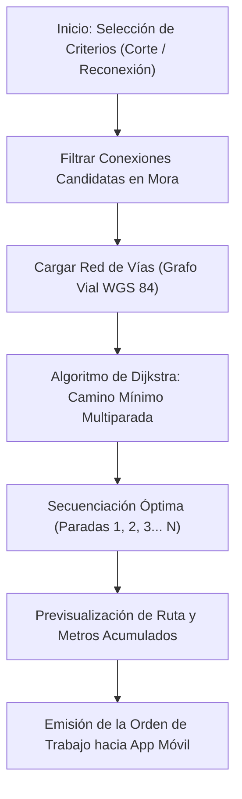

# 🎓 UNIVERSIDAD AUTÓNOMA GABRIEL RENÉ MORENO
### Facultad de Ingeniería en Ciencias de la Computación y Telecomunicaciones
**Materia:** Sistemas de Información Geográfica (INF422 / SIG)  
**Docente:** Ing. Ubaldo Pérez Ferreira  
**Estudiante:** Mendieta Cari Miguel Angel  
**Semestre Académico:** 2/2026  
**Lugar:** Santa Cruz de la Sierra — Bolivia  

---

# 📘 MANUAL DE USUARIO OFICIAL DEL SISTEMA
## Sistema de Información Geográfica Corporativo y Visor Cartográfico Territorial — **VisorDatosSIG 2026**
### Módulo Integral de Catastro, Redes Viales y Gestión de Cortes y Reconexiones de Agua Potable

---

> **Sistema:** VisorDatosSIG 2026  
> **Versión de la Solución:** v2026.2.0 (Segunda Parte: Alcance SIG 2/2026)  
> **Fecha de Publicación:** Noviembre 2026  
> **Área Territorial:** San Ignacio de Velasco / Municipio Modelo  
> **Sistema de Referencia Espacial:** EPSG:4326 (WGS 84 - Latitud / Longitud en Grados Decimales)  
> **Pila Tecnológica:** ASP.NET Core MVC / Web API (.NET 8), Leaflet.js, Bootstrap 5, Flutter 3.x (Móvil), WinForms .NET 8 (Desktop ETL) y Microsoft SQL Server 2022 Spatial  

---

## 📑 ÍNDICE GENERAL

1. [Introducción y Visión General del Ecosistema](#1-introducción-y-visión-general-del-ecosistema)
   - 1.1 [Propósito del Sistema](#11-propósito-del-sistema)
   - 1.2 [Componentes del Ecosistema](#12-componentes-del-ecosistema)
   - 1.3 [Requisitos de Hardware y Software](#13-requisitos-de-hardware-y-software)
   - 1.4 [Perfiles y Roles de Usuario](#14-perfiles-y-roles-de-usuario)
2. [Acceso, Autenticación y Seguridad](#2-acceso-autenticación-y-seguridad)
   - 2.1 [Pantalla de Inicio de Sesión Web](#21-pantalla-de-inicio-de-sesión-web)
   - 2.2 [Políticas de Seguridad y Bloqueo por Fuerza Bruta](#22-políticas-de-seguridad-y-bloqueo-por-fuerza-bruta)
   - 2.3 [Cierre de Sesión Seguro](#23-cierre-de-sesión-seguro)
3. [Módulo 1: Visor Cartográfico Territorial (GIS Web)](#3-módulo-1-visor-cartográfico-territorial-gis-web)
   - 3.1 [Estructura de la Pantalla Principal](#31-estructura-de-la-pantalla-principal)
   - 3.2 [Gestión de Capas y Simbología Temática](#32-gestión-de-capas-y-simbología-temática)
   - 3.3 [Galería de Mapas Base Cartográficos](#33-galería-de-mapas-base-cartográficos)
   - 3.4 [Modo de Interfaz (Claro / Oscuro)](#34-modo-de-interfaz-claro--oscuro)
   - 3.5 [Barra de Herramientas de Análisis Espacial](#35-barra-de-herramientas-de-análisis-espacial)
     - 3.5.1 [Identificación de Elementos por Clic / Toque](#351-identificación-de-elementos-por-clic--toque)
     - 3.5.2 [Medición de Distancias Lineales](#352-medición-de-distancias-lineales)
     - 3.5.3 [Medición de Superficies Poligonales (Áreas)](#353-medición-de-superficies-poligonales-áreas)
     - 3.5.4 [Geolocalización GPS del Usuario ("Mi Ubicación")](#354-geolocalización-gps-del-usuario-mi-ubicación)
     - 3.5.5 [Localizador por Coordenadas WGS 84](#355-localizador-por-coordenadas-wgs-84)
     - 3.5.6 [Restablecer Extensión Territorial](#356-restablecer-extensión-territorial)
     - 3.5.7 [Exportación de Geometría a WKT (Well-Known Text)](#357-exportación-de-geometría-a-wkt-well-known-text)
   - 3.6 [Búsqueda Alfanumérica y Filtros Avanzados](#36-búsqueda-alfanumérica-y-filtros-avanzados)
   - 3.7 [Sincronización Bidireccional Tabla-Mapa y Exportación CSV](#37-sincronización-bidireccional-tabla-mapa-y-exportación-csv)
   - 3.8 [Navegación Móvil (Quick Dock y Bottom Drawer)](#38-navegación-móvil-quick-dock-y-bottom-drawer)
4. [Módulo 2: Gestión de Cortes y Reconexiones de Agua Potable](#4-módulo-2-gestión-de-cortes-y-reconexiones-de-agua-potable)
   - 4.1 [Estados Semafóricos de las Conexiones](#41-estados-semafóricos-de-las-conexiones)
   - 4.2 [Filtro Rápido de Estados en el Visor](#42-filtro-rápido-de-estados-en-el-visor)
   - 4.3 [Dashboard Gerencial y KPIs de Saneamiento](#43-dashboard-gerencial-y-kpis-de-saneamiento)
   - 4.4 [Planificación y Asignación de Rutas con Algoritmo de Dijkstra](#44-planificación-y-asignación-de-rutas-con-algoritmo-de-dijkstra)
   - 4.5 [Monitoreo Satelital y Telemetría en Tiempo Real](#45-monitoreo-satelital-y-telemetría-en-tiempo-real)
5. [Módulo 3: Aplicación Móvil para Cuadrillas de Campo (Flutter)](#5-módulo-3-aplicación-móvil-para-cuadrillas-de-campo-flutter)
   - 5.1 [Inicio de Sesión del Operario en el Móvil](#51-inicio-de-sesión-del-operario-en-el-móvil)
   - 5.2 [Bandeja de Tareas y Asignación del Día](#52-bandeja-de-tareas-y-asignación-del-día)
   - 5.3 [Navegación Secuencial y Visualización de la Ruta Óptima](#53-navegación-secuencial-y-visualización-de-la-ruta-óptima)
   - 5.4 [Registro Técnico de la Tarea en Terreno](#54-registro-técnico-de-la-tarea-en-terreno)
   - 5.5 [Captura de Fotografía y Evidencia Digital](#55-captura-de-fotografía-y-evidencia-digital)
   - 5.6 [Validación Antifraude por GPS y Registro de Observaciones](#56-validación-antifraude-por-gps-y-registro-de-observaciones)
6. [Módulo 4: Herramienta de Escritorio ETL (VisorDatosSIG.Migrador)](#6-módulo-4-herramienta-de-escritorio-etl-visordatossigmigrador)
   - 6.1 [Conexión a la Base de Datos Espacial](#61-conexión-a-la-base-de-datos-espacial)
   - 6.2 [Selección e Inspección de Archivos Shapefile ESRI](#62-selección-e-inspección-de-archivos-shapefile-esri)
   - 6.3 [Validación Automática de Integridad y SRID 4326](#63-validación-automática-de-integridad-y-srid-4326)
   - 6.4 [Previsualización de Atributos y Mapeo de Columnas](#64-previsualización-de-atributos-y-mapeo-de-columnas)
   - 6.5 [Modalidades de Ingesta (Reemplazar vs. Anexar)](#65-modalidades-de-ingesta-reemplazar-vs-anexar)
   - 6.6 [Ejecución Transaccional por Lotes y Bitácora](#66-ejecución-transaccional-por-lotes-y-bitácora)
7. [Módulo 5: Administración y Seguridad del Sistema (Backoffice)](#7-módulo-5-administración-y-seguridad-del-sistema-backoffice)
   - 7.1 [Gestión de Usuarios y Credenciales](#71-gestión-de-usuarios-y-credenciales)
   - 7.2 [Matriz de Permisos Granulares (PBAC - Feature Flags)](#72-matriz-de-permisos-granulares-pbac---feature-flags)
   - 7.3 [Bitácora Inmutable de Auditoría de Eventos](#73-bitácora-inmutable-de-auditoría-de-eventos)
   - 7.4 [Historial de Migraciones Espaciales](#74-historial-de-migraciones-espaciales)
8. [Preguntas Frecuentes (FAQ) y Resolución de Problemas](#8-preguntas-frecuentes-faq-y-resolución-de-problemas)
9. [Glosario de Términos](#9-glosario-de-términos)

---

## 1. INTRODUCCIÓN Y VISIÓN GENERAL DEL ECOSISTEMA

### 1.1 Propósito del Sistema

**VisorDatosSIG 2026** es una solución corporativa integral diseñada para la gestión territorial, administración catastral urbana, fiscalización de redes de servicios y control operativo de cuadrillas en campo. Integra en una única plataforma un visor geográfico web interactivo, un módulo especializado de gestión de cortes y reconexiones de agua potable con cálculo de rutas óptimas mediante el algoritmo de Dijkstra sobre la red vial, una aplicación móvil para cuadrillas de terreno y un software de escritorio para ingesta masiva de cartografía Shapefile.

### 1.2 Componentes del Ecosistema

```
+-----------------------------------------------------------------------------------------------+
|                                     ECOSISTEMA VISORDATOSSIG 2026                             |
+-----------------------------------------------------------------------------------------------+
|                                                                                               |
|   1. PORTAL WEB PRINCIPAL (ASP.NET Core MVC + Leaflet.js + Bootstrap 5)                      |
|      - Visor Cartográfico de Capas Territoriales (Manzanas, Lotes, Vías, Vértices, Agua)     |
|      - Herramientas de Medición (Distancia, Área), Identificación y Exportación CSV/WKT       |
|      - Planificador de Rutas Óptimas de Cortes/Reconexiones (Algoritmo Dijkstra)             |
|      - Dashboard de Indicadores de Servicio y Monitoreo Satelital en Tiempo Real de Operarios |
|      - Módulo Backoffice de Seguridad, Usuarios, Roles PBAC y Bitácora de Auditoría          |
|                                                                                               |
|   2. APLICACIÓN MÓVIL OPERATIVA (Flutter / Dart - Android & iOS)                             |
|      - Recepción de Hoja de Ruta Asignada al Trabajador (Cortador / Reconector)               |
|      - Mapa de Navegación Secuencial (Puntos 1, 2, 3...) respetando la Red Vial               |
|      - Ficha de Registro de Campo: Foto de Evidencia, Lectura de Medidor, GPS y Observaciones|
|      - Telemetría en Vivo hacia el Panel Central de Monitoreo                                 |
|                                                                                               |
|   3. HERRAMIENTA DE ESCRITORIO ETL (WinForms .NET 8 - VisorDatosSIG.Migrador)                |
|      - Ingesta y Validación Binaria Nativa de Shapefiles ESRI (.shp, .shx, .dbf, .prj)        |
|      - Validación Criptográfica y Espacial WGS 84 (SRID 4326 Obligatorio)                     |
|      - Carga Masiva Transaccional por Lotes (Batch Processing) con Reversión (Rollback)      |
|                                                                                               |
|   4. MOTOR DE BASE DE DATOS ESPACIAL (Microsoft SQL Server 2022 Spatial)                     |
|      - Tipos Geométricos GEOMETRY WGS 84, Índices Espaciales R-Tree / Grid y Stored Procedures|
+-----------------------------------------------------------------------------------------------+
```

### 1.3 Requisitos de Hardware y Software

| Componente | Requisito Mínimo Recomendado |
| :--- | :--- |
| **Navegador Web (Portal SIG)** | Google Chrome 110+, Mozilla Firefox 110+, Microsoft Edge 110+, Safari 16+ con JavaScript habilitado |
| **Resolución de Pantalla Web** | 1366x768 píxeles en PC/Laptop. Totalmente adaptable a tablets y móviles (360px a 1080px) |
| **Dispositivo Móvil de Campo** | Teléfono o Tablet con Android 10.0+ o iOS 14.0+, con receptor GPS y cámara fotográfica integrados |
| **Conexión a Red (Móvil)** | Red móvil 4G/5G o conexión Wi-Fi para sincronización de rutas y fotos |
| **Herramienta ETL WinForms** | Windows 10/11 x64, .NET Runtime 8.0, 4 GB de memoria RAM, conexión TCP/IP hacia el servidor de base de datos |

### 1.4 Perfiles y Roles de Usuario

El sistema cuenta con un esquema de control de acceso híbrido **RBAC** (Roles) y **PBAC** (Permisos específicos):

*   **Administrador del Sistema (`admin`):** Control total de la plataforma. Configuración de capas cartográficas, creación y asignación de usuarios y permisos, auditoría forense de accesos, monitoreo y migraciones.
*   **Consultor / Operador SIG (`consultor`):** Visualización interactiva de capas cartográficas, consultas alfanuméricas, filtros espaciales, herramientas de medición métrica, localización y exportación de datos.
*   **Supervisor de Cortes y Reconexiones:** Acceso al dashboard gerencial de agua potable, generación de hojas de trabajo, cálculo de rutas óptimas con Dijkstra y monitoreo satelital en vivo de los operarios.
*   **Operador de Migración ETL:** Especialista técnico encargado de cargar los archivos cartográficos Shapefiles hacia la base de datos centralizada utilizando la herramienta de escritorio.
*   **Operario de Cuadrilla en Terreno (`TRAB-001`, `TRAB-002`, etc.):** Personal de campo clasificado como *Cortador* o *Reconector*. Opera la aplicación móvil, visualiza la ruta asignada, captura lecturas, fotografías y registra estados de ejecución.

---

## 2. ACCESO, AUTENTICACIÓN Y SEGURIDAD

### 2.1 Pantalla de Inicio de Sesión Web

Para ingresar al portal web:
1. Abra el navegador web e ingrese a la dirección URL oficial (por ejemplo: `http://servidor-sig:5000/Login` o `https://sig.empresa.com/Login`).
2. Aparecerá la ventana de autenticación con el logotipo corporativo.
3. Complete los campos requeridos:
   - **Nombre de Usuario:** Ingrese su nombre de usuario asignado (ej. `admin` o `consultor`).
   - **Contraseña:** Ingrese su clave de seguridad (debidamente cifrada mediante PBKDF2-HMAC-SHA512).
4. Presione el botón **"Iniciar Sesión"**.
5. Si las credenciales son válidas, el sistema establecerá una cookie cifrada de sesión segura (`HttpOnly`, `SameSite`) y lo redirigirá inmediatamente al Visor Cartográfico o a la vista autorizada según su perfil.

```
+-------------------------------------------------------+
|                VisorDatosSIG 2026                     |
|           Acceso al Sistema Territorial               |
+-------------------------------------------------------+
|  Usuario:     [ admin                               ] |
|  Contraseña:  [ •••••••••••••                       ] |
|                                                       |
|  [         INICIAR SESIÓN SEGURA                   ]  |
+-------------------------------------------------------+
```

### 2.2 Políticas de Seguridad y Bloqueo por Fuerza Bruta

> [!IMPORTANT]
> El sistema implementa una política estricta de protección criptográfica:
> *   **Límite de Intentos:** Si un usuario ingresa una contraseña incorrecta **5 veces consecutivas**, la cuenta queda **bloqueada temporalmente por 15 minutos**.
> *   **Bitácora Automática:** Cada intento fallido queda registrado en la bitácora de auditoría con la dirección IP de origen, fecha/hora exacta y agente de navegación.
> *   **Desbloqueo:** Tras los 15 minutos de penalización, el sistema restituye automáticamente el acceso, o bien un Administrador puede reactivar la cuenta manualmente desde el panel de usuarios.

### 2.3 Cierre de Sesión Seguro

Para salvaguardar la confidencialidad de la información geográfica:
1. En la esquina superior derecha del menú de navegación, haga clic sobre su nombre de usuario.
2. Seleccione la opción **"Cerrar Sesión"**.
3. El sistema invalidará la sesión en el servidor, destruirá las cookies de autorización en el navegador y lo devolverá a la pantalla de Login.

---

## 3. MÓDULO 1: VISOR CARTOGRÁFICO TERRITORIAL (GIS WEB)

### 3.1 Estructura de la Pantalla Principal

El visor cartográfico está diseñado a pantalla completa (*full screen viewport*) con componentes interactivos flotantes:

```
+-----------------------------------------------------------------------------------------------+
| [LOGO] VisorDatosSIG 2026   [Módulo Agua v]  [Administración v]        [Tema ☀️/🌙] [admin (Cerrar)]|
+-----------------------------------------------------------------------------------------------+
| [TAB-CAPAS] [TAB-BUSQUEDA] [TAB-HERRAMIENTAS]   |                                             |
| ----------------------------------------------- |                                             |
| [x] Manzanas Urbanas          [Zoom] (90%)      |               LIENZO CARTOGRÁFICO           |
| [x] Lotes Catastrales         [Zoom] (85%)      |                   (LEAFLET.JS)              |
| [x] Red de Vías Urbanas       [Zoom] (100%)     |                                             |
| [x] Códigos Fijos (Vértices)  [Zoom] (100%)     |        * Manzanas y Lotes coloreados        |
| [x] Conexiones de Agua        [Zoom] (95%)      |        * Marcadores de medidores            |
|                                                 |        * Red de calles trazada              |
| -- Filtro Conexiones Agua:                      |                                             |
| [x] Normal [x] ParaCorte [x] Cortado            |                                             |
|                                                 |     [+ / - Control Zoom]                    |
| -- Capa Base: [OSM] [Carto] [Dark] [Satélite]   |     [Simbología Flotante v]                 |
|                                                 |                                             |
+-----------------------------------------------------------------------------------------------+
| HUD: Lon: -60.96915 | Lat: -16.38198 | Zoom: 14 | EPSG:4326 (WGS 84)                          |
+-----------------------------------------------------------------------------------------------+
```

1. **Lienzo del Mapa (`#map`):** Superficie dinámica donde se renderizan las capas vectoriales en formato GeoJSON mediante compresión de transferencia.
2. **Panel Lateral Desplegable (Sidebar Izquierdo):** Contiene tres pestañas funcionales: **Capas**, **Búsqueda** y **Herramientas**.
3. **HUD Inferior de Coordenadas:** Muestra en tiempo real la Longitud, Latitud, nivel de Zoom y el sistema de referencia espacial (**EPSG:4326 WGS 84**).
4. **Leyenda Flotante (Simbología):** Desplegable en el borde derecho inferior que sintetiza la codificación cromática de cada capa visible.
5. **Panel Desplegable de Detalles (Drawer / Bottom Sheet):** Panel flotante que muestra la ficha técnica completa del elemento consultado.

### 3.2 Gestión de Capas y Simbología Temática

En la pestaña **"Capas"** del panel lateral usted puede controlar la visualización de los datos espaciales:

*   **Activar / Desactivar Capa:** Marque o desmarque el interruptor (*switch*) situado junto al nombre de la capa. Al desactivarla, los polígonos, líneas o puntos desaparecen inmediatamente del mapa.
*   **Ajuste Dinámico de Opacidad:** Utilice la barra deslizante (0% a 100%) debajo de cada capa para otorgar transparencia a polígonos densos y permitir ver el mapa base o capas inferiores.
*   **Botón Enfocar Capa (`Crosshair`):** Al presionar el botón de mira junto a la capa, el mapa realizará un zoom panorámico (*FitBounds*) ajustando la vista a la extensión territorial total de esa capa.

```
Capas Disponibles en el Catálogo:
* Manzanas Urbanas: Delimitación de unidades territoriales (Color violeta translúcido).
* Lotes Catastrales: Predios individuales con número de predio y titular (Borde dorado, relleno ámbar).
* Red Vial: Ejes de calles y avenidas clasificadas por jerarquía (Líneas grises/azules).
* Códigos Fijos: Vértices geodésicos, hitos y cotas de nivel Z (Puntos cian destacados).
* Conexiones de Agua: Medidores domiciliarios georreferenciados (Puntos semafóricos por estado de servicio).
```

### 3.3 Galería de Mapas Base Cartográficos

El sistema permite alternar en cualquier momento el mapa cartográfico de fondo:
*   **OpenStreetMap (OSM):** Cartografía estándar urbana con nombres de calles, comercios y puntos de referencia.
*   **Carto Positron:** Mapa en tonos claros y neutros, ideal para resaltar capas de zonificación y lotes de colores intensos.
*   **Carto Dark:** Mapa oscuro de alto contraste, ideal para análisis nocturno y visualización de puntos de corte de agua.
*   **Esri Satelital:** Ortofotografía satelital de alta resolución para contrastar construcciones reales contra la cartografía catastral.

### 3.4 Modo de Interfaz (Claro / Oscuro)

En la sección inferior de la pestaña Capas, o en la barra superior:
*   Haga clic en **"Modo Oscuro 🌙"** o **"Modo Claro ☀️"**.
*   El sistema alterará instantáneamente todas las variables CSS de fondo, paneles laterales, modales y tablas de datos para evitar la fatiga visual. Su preferencia queda guardada en el navegador (`localStorage`).

### 3.5 Barra de Herramientas de Análisis Espacial

En la pestaña **"Herramientas"** del panel lateral, se encuentran las utilidades geométricas avanzadas:

#### 3.5.1 Identificación de Elementos por Clic / Toque
*   Es la herramienta activa por defecto.
*   Haga clic sobre cualquier lote, manzana, vía o medidor en el mapa.
*   El elemento se resaltará en color cian luminoso y se desplegará el **Panel de Ficha Técnica** con todos sus atributos: titular, código catastral, área en $m^2$, perímetro, estado de servicio, dirección, etc.

#### 3.5.2 Medición de Distancias Lineales
1. Haga clic en la herramienta **"Medir Distancia Lineal"**.
2. Haga clic en el mapa sobre el punto de inicio.
3. Desplace el ratón y haga clics sucesivos en los quiebres de la calle o predio que desea medir.
4. El sistema trazará una línea punteada y un indicador emergente mostrará la distancia acumulada en **metros (m)** y **kilómetros (km)**.
5. Haga doble clic para finalizar la medición.

#### 3.5.3 Medición de Superficies Poligonales (Áreas)
1. Active la herramienta **"Medir Área Poligonal"**.
2. Haga clic en cada uno de los vértices del polígono territorial a medir.
3. El sistema coloreará el interior del polígono en tiempo real.
4. Al cerrar el polígono, se presentará el cálculo automático en **metros cuadrados ($m^2$)** y en **hectáreas (ha)**.

#### 3.5.4 Geolocalización GPS del Usuario ("Mi Ubicación")
1. Haga clic en **"Detectar Mi Ubicación"**.
2. Si el navegador le solicita permiso de ubicación, presione **"Permitir"**.
3. El mapa se centrará en sus coordenadas actuales de latitud/longitud y trazará un círculo azul que representa el margen de precisión estimado de su receptor GPS.

#### 3.5.5 Localizador por Coordenadas WGS 84
1. En la caja de herramientas, ingrese la **Longitud (X)** (ej. `-60.969150`) y la **Latitud (Y)** (ej. `-16.381980`).
2. Presione el botón **"Centrar Coordenadas"**.
3. El mapa se posicionará en el punto exacto con un marcador temporal pulsante.

#### 3.5.6 Restablecer Extensión Territorial
*   Presione **"Restablecer Extensión Inicial"**.
*   El mapa regresará al encuadre predeterminado del municipio (San Ignacio de Velasco) con zoom nivel 14.

#### 3.5.7 Exportación de Geometría a WKT (Well-Known Text)
*   Cuando tenga un elemento seleccionado en el panel de detalles, haga clic en el botón **"Copiar WKT"**.
*   La geometría matemática (`POLYGON(...)`, `LINESTRING(...)` o `POINT(...)`) se copiará a su portapapeles, lista para pegarse en AutoCAD, QGIS, ArcGIS o sentencias SQL.

### 3.6 Búsqueda Alfanumérica y Filtros Avanzados

Para localizar rápidamente un predio o elemento:
1. Diríjase a la pestaña **"Búsqueda"** en el panel lateral.
2. En la lista desplegable, puede optar por buscar en **"Todas las capas"** o restringir la consulta a una específica (ej. *Lotes Catastrales* o *Conexiones de Agua*).
3. Escriba el criterio de búsqueda (código de predio, nombre o apellido del titular, manzana o nombre de vía).
4. Presione **"Buscar"** o la tecla *Enter*.
5. Se listarán todos los registros coincidentes con su respectivo código, tipo de elemento e información relevante.

### 3.7 Sincronización Bidireccional Tabla-Mapa y Exportación CSV

*   **Enfoque desde la lista:** Haga clic sobre cualquiera de los resultados de búsqueda. Automáticamente el visor cartográfico se desplazará (*Pan*), aplicará zoom y resaltará la geometría correspondiente en el mapa.
*   **Ver Todos:** Si presiona el botón **"Ver todos (Zoom)"**, el visor encuadrará en pantalla todas las geometrías que coincidieron con su búsqueda.
*   **Exportar a CSV:** En la parte inferior de los resultados, presione **"Exportar a CSV"** para descargar una hoja de cálculo en formato UTF-8 con todos los atributos alfanuméricos encontrados.

### 3.8 Navegación Móvil (Quick Dock y Bottom Drawer)

En teléfonos móviles y pantallas táctiles pequeñas:
*   Aparece en la parte inferior una barra de acceso rápido (**Mobile Dock**) con accesos directos a: *Capas*, *Búsqueda*, *Herramientas* y *Centrar GPS*.
*   La información de los lotes se despliega en una tarjeta deslizable inferior (**Bottom Sheet**) que el usuario puede subir o minimizar arrastrando el tirador (*drawer handle*), garantizando una experiencia 100% nativa y sin bloqueos de pantalla.

---

## 4. MÓDULO 2: GESTIÓN DE CORTES Y RECONEXIONES DE AGUA POTABLE

### 4.1 Estados Semafóricos de las Conexiones

El módulo de agua potable clasifica las conexiones y medidores del territorio bajo cuatro estados operativos universales:

| Estado | Color Simbólico | Significado Operativo | Criterio de Activación |
| :--- | :---: | :--- | :--- |
| **Normal** | 🟢 Verde | Servicio activo y al día | Sin mora pendiente o mora menor a 2 meses |
| **Para Corte** | 🟡 Naranja/Ámbar | Pendiente de corte físico en terreno | Mora mayor a 2 meses o saldo vencido acumulado |
| **Cortado** | 🔴 Rojo | Servicio suspendido físicamente | Válvula precintada o servicio interrumpido por cuadrilla |
| **Baja Parcial** | ⚪ Azul/Grisáceo | Medidor retirado o precintado temporal | Retiro de medidor por solicitud o corte judicial |

### 4.2 Filtro Rápido de Estados en el Visor

En el visor cartográfico principal, en la pestaña Capas, existe la sección **"Filtro por Estado de Conexión"**:
*   Puede tildar o destildar individualmente las casillas: *Normal*, *Para Corte*, *Cortado* y *Baja Parcial*.
*   Al destildar, por ejemplo, los medidores "Normales", el mapa mostrará exclusivamente los puntos que demandan atención operativa (cortes y reconexiones), despejando el plano urbano.

### 4.3 Dashboard Gerencial y KPIs de Saneamiento

Para acceder al centro de mando gerencial, ingrese al menú superior **Módulo Agua > Dashboard**.

```
+-----------------------------------------------------------------------------------------------+
| DASHBOARD GENERAL DEL SERVICIO DE AGUA POTABLE                                                |
+-----------------------------------------------------------------------------------------------+
|  TOTAL CONEXIONES      |  CONEXIONES PARA CORTE |  SERVICIOS CORTADOS    |  EFECTIVIDAD       |
|       1,248            |         84             |         32             |      94.2%         |
|  (100% Georref.)       |    (Mora > 2 meses)    |   (En espera reconex.) |  (Rutas cumplidas) |
+-----------------------------------------------------------------------------------------------+
|  [Gráfico de Deuda por Sector]                  |  [Avance de Cuadrillas en Terreno]          |
|  - Sector Norte: 45 cortes pendientes           |  - Cuadrilla 1 (Moto): 12/15 completados    |
|  - Sector Centro: 22 cortes pendientes          |  - Cuadrilla 2 (A pie): 8/10 completados    |
|  - Sector Sur: 17 cortes pendientes             |  - Cuadrilla 3 (Moto): 14/14 completados    |
+-----------------------------------------------------------------------------------------------+
```

El panel proporciona:
1. **Tarjetas KPI en tiempo real:** Total de usuarios conectados, usuarios en condición de corte, servicios cortados y monto total de cartera en mora.
2. **Acciones Rápidas:** Botones directos para crear una *Nueva Asignación*, saltar al *Monitoreo en Vivo* o volver al *Mapa General*.

### 4.4 Planificación y Asignación de Rutas con Algoritmo de Dijkstra

Para organizar el trabajo de campo de manera científicamente eficiente sin cruzar manzanas a campo traviesa:
1. Vaya a **Módulo Agua > Asignaciones** y presione **"+ Nueva Asignación"**.
2. Configure los parámetros de la orden:
   - **Tipo de Servicio:** Elija `Corte de Servicio (Mora)` o `Reconexión de Servicio`.
   - **Operario Asignado:** Seleccione de la lista al trabajador disponible (el sistema filtrará automáticamente a los clasificados como *Cortador* o *Reconector* según el servicio).
   - **Punto de Partida:** Indique el punto de origen de la cuadrilla (ej. *Almacén Central*, *Oficina Comercial* o coordenadas personalizadas).
   - **Criterio de Selección Territorial:** Elija el barrio o sector geográfico y la cantidad máxima de puntos a atender en la jornada (ej. 15 puntos).
3. Presione el botón **"Calcular Ruta Óptima (Dijkstra)"**.
4. **Procesamiento de Grafo:** El algoritmo analiza el grafo de la red vial urbana (capa de Vías), encuentra el camino más corto entre cada punto sin atravesar predios privados y ordena los puntos en una secuencia lógica estricta: **Punto 1 $\rightarrow$ Punto 2 $\rightarrow$ Punto 3 ... $\rightarrow$ Punto N**.
5. El sistema muestra la distancia total en metros a recorrer y el mapa interactivo con la línea de ruta proyectada.
6. Presione **"Confirmar y Asignar Orden"**. La ruta quedará programada y disponible instantáneamente en el teléfono móvil del operario asignado.



### 4.5 Monitoreo Satelital y Telemetría en Tiempo Real

Para supervisar la seguridad y productividad de las brigadas:
1. Vaya a **Módulo Agua > Monitoreo en Vivo**.
2. Se cargará un mapa dinámico con un panel lateral de cuadrillas:
   - **Marcadores de Operarios:** Iconos de operarios en moto o a pie, identificados con nombre y código.
   - **Indicador de Conexión:** Señal verde pulsante si el operario emitió coordenadas en los últimos 2 minutos.
   - **Nivel de Batería:** Porcentaje de batería del dispositivo móvil del trabajador.
   - **Barra de Avance:** Barra de progreso porcentual que muestra cuántos puntos de corte/reconexión ya fueron ejecutados respecto al total asignado.
3. Al hacer clic sobre cualquier operario en la lista lateral, el mapa hace foco sobre su posición exacta en la calle.

---

## 5. MÓDULO 3: APLICACIÓN MÓVIL PARA CUADRILLAS DE CAMPO (FLUTTER)

### 5.1 Inicio de Sesión del Operario en el Móvil

1. En el teléfono móvil del operario, abra la aplicación **VisorDatosSIG Móvil**.
2. Aparecerá la pantalla de bienvenida solicitando credenciales.
3. Ingrese el **Código de Trabajador** (ej. `TRAB-001`) y su contraseña (por defecto: `123456`).
4. Si la cuadrilla cuenta con varios operarios, la app ofrece un selector rápido de personal activo.
5. Presione **"INGRESAR AL SISTEMA"**.
6. Conceda los permisos de **Ubicación (GPS)** y **Cámara** cuando la aplicación los solicite.

### 5.2 Bandeja de Tareas y Asignación del Día

Al iniciar sesión, la app consulta al servidor central:
*   Si el operario tiene una ruta asignada para la fecha, se desplegará la tarjeta resumen con el código de asignación (ej. `ASIG-2026-0001`), la cantidad total de puntos a visitar y la distancia estimada.
*   En pantalla se listan las tareas ordenadas del **1 al N**.
*   Cada tarjeta exhibe:
    - Número de parada secuencial (Badge destacado).
    - Código de Conexión y Número de Medidor.
    - Nombre del Titular y Dirección predial.
    - Monto adeudado y meses de mora.
    - Estado de la tarea: *Pendiente* (gris), *Ejecutado* (verde), *Casa Cerrada* (naranja), *Imposible* (rojo).

### 5.3 Navegación Secuencial y Visualización de la Ruta Óptima

*   En la parte superior o en la pestaña **"Mapa de Ruta"**, el operario puede visualizar toda la red de paradas conectadas por la polilínea calculada por Dijkstra.
*   Al seleccionar una parada específica, presione el botón **"Cómo llegar"** o **"Iniciar Navegación"**.
*   La app guiará al operario respetando las calles urbanas hasta el medidor correspondiente.

### 5.4 Registro Técnico de la Tarea en Terreno

Una vez situado frente al predio y medidor:
1. En la lista de tareas, toque sobre el punto correspondiente para abrir la **Ficha de Registro de Campo**.
2. **Verificación de Medidor:** Compare el número de medidor físico grabado en la tapa contra el código indicado en pantalla. Si no coincide, corrija el campo *Número Medidor Verificado*.
3. **Lectura Actual:** Ingrese el valor numérico en metros cúbicos ($m^3$) que marca la carátula del medidor.
4. **Estado del Servicio:** Seleccione el resultado de la visita:
   - `Ejecutado`: El corte o reconexión se efectuó con éxito.
   - `Casa Cerrada`: No fue posible acceder al medidor por estar dentro de reja con candado.
   - `Imposible`: Válvula rota, agresión, perro bravo u obstrucción física severa.
   - `Rechazado`: El abonado presentó comprobante de pago reciente en ventanilla.

### 5.5 Captura de Fotografía y Evidencia Digital

> [!TIP]
> **Obligatoriedad de Fotografía:** Para auditoría y respaldo contra reclamos de clientes, se exige foto de evidencia en todos los cortes.
1. Presione el botón **"Tomar Fotografía del Medidor"** (icono de cámara).
2. Se abrirá la cámara nativa del teléfono.
3. Enfoque con nitidez el medidor, mostrando el precinto instalado (en cortes) o la llave abierta (en reconexiones) y la carátula de lectura.
4. Presione capturar y confirme la fotografía. La imagen se previsualizará en la ficha.

### 5.6 Validación Antifraude por GPS y Registro de Observaciones

*   **Auditoría GPS Invisible:** En el momento exacto en que el operario presiona **"Guardar y Enviar Registro"**, la aplicación móvil captura las coordenadas satelitales del dispositivo y su margen de error en metros.
*   **Cálculo de Discrepancia:** El sistema compara la ubicación del operario con las coordenadas registradas en el catastro para ese medidor. Si el operario intentara registrar el corte a kilómetros de distancia del predio, la plataforma genera una alerta de discrepancia geográfica para el supervisor.
*   **Observaciones Adicionales:** Puede redactar notas breves (ej. "Se dejó boleta de notificación bajo la puerta", "Llave con fuga leve").
*   Al guardar, la tarea se marca con un tilde verde y la cuadrilla puede avanzar al punto siguiente.

---

## 6. MÓDULO 4: HERRAMIENTA DE ESCRITORIO ETL (VISORDATOSSIG.MIGRADOR)

La aplicación de escritorio **VisorDatosSIG.Migrador** (desarrollada en C# .NET 8 WinForms) es la herramienta oficial para la ingesta de archivos cartográficos de los municipios o empresas de servicios hacia SQL Server 2022 Spatial.

```
+-----------------------------------------------------------------------------------------------+
| VISORDATOSSIG MIGRATION TOOL v2026.1                                              [_] [X]     |
+-----------------------------------------------------------------------------------------------+
| CONEXIÓN A BASE DE DATOS ESPACIAL:                                                            |
| Servidor: [ localhost\SQLEXPRESS         ]  BD: [ VisorDatosSIG_BD       ]  [x] Integ. Win    |
| Usuario:  [ sa                           ]  Pass: [ ••••••••              ]  [Probar Conexión]|
| Estado:   (🟢 Conexión Exitosa con SQL Server 2022 Spatial - SRID 4326)                      |
+-----------------------------------------------------------------------------------------------+
| ORIGEN DE ARCHIVOS SHAPEFILE (.SHP):                                                          |
| Directorio: [ C:\Cartografia_2026\Shapes\                         ] [Examinar...] [Validar]   |
+-----------------------------------------------------------------------------------------------+
| CAPAS CARTOGRÁFICAS DETECTADAS:                                                               |
| [x] Manzanas.shp    | Polygon    | 1,240 registros | CRS: WGS 84 (SRID 4326) | VÁLIDO ✅       |
| [x] Lotes.shp        | Polygon    | 8,920 registros | CRS: WGS 84 (SRID 4326) | VÁLIDO ✅       |
| [x] Vias.shp         | LineString | 3,410 registros | CRS: WGS 84 (SRID 4326) | VÁLIDO ✅       |
| [x] CodigosFijos.shp | Point      |   450 registros | CRS: WGS 84 (SRID 4326) | VÁLIDO ✅       |
+-----------------------------------------------------------------------------------------------+
| OPCIONES DE CARGA:                                                                            |
| Modalidad: (o) Reemplazar Capa Completa   ( ) Anexar Registros Nuevos                         |
| Usuario Migrador: [ operador_gis                                         ]                    |
| [==================================== 100% ===================================]               |
|                                                                                               |
| [ INICIAR MIGRACIÓN POR LOTES ]                       [ CANCELAR ]           [ EXPORTAR LOG ] |
+-----------------------------------------------------------------------------------------------+
```

### 6.1 Conexión a la Base de Datos Espacial

1. Ejecute el archivo `VisorDatosSIG.Migrador.exe`.
2. En la sección superior **Conexión a Base de Datos**:
   - Ingrese el nombre del servidor (ej. `localhost\SQLEXPRESS` o la IP del servidor de BD).
   - Indique la base de datos: `VisorDatosSIG_BD`.
   - Si utiliza autenticación de dominio, marque la casilla **"Seguridad Integrada"**. De lo contrario, ingrese el usuario y contraseña de SQL Server.
3. Presione el botón **"Probar Conexión"**. Debe observar la confirmación en verde: *"Conexión Exitosa"*.

### 6.2 Selección e Inspección de Archivos Shapefile ESRI

1. Presione **"Examinar Carpeta"** para procesar un lote completo de capas, o **"Examinar Archivo"** para un Shapefile individual.
2. Seleccione la carpeta donde residen los archivos. Cada conjunto debe contener obligatoriamente sus cuatro componentes:
   - `.shp` (Geometría espacial).
   - `.shx` (Índice de posiciones geométricas).
   - `.dbf` (Tabla de atributos alfanuméricos dBASE).
   - `.prj` (Definición matemática de proyección cartográfica).

### 6.3 Validación Automática de Integridad y SRID 4326

Al pulsar **"Inspeccionar y Validar"**, el lector binario interno verifica:
*   Que el archivo `.shp` contenga una cabecera ESRI válida (código mágico `9994`).
*   Que el archivo `.prj` defina exactamente la proyección geográfica **WGS 84 / EPSG:4326**.

> [!CAUTION]
> Si el archivo `.prj` se encuentra ausente o especifica una proyección local (ej. UTM Proyectada o PSAD56) sin transformar, la herramienta mostrará una alerta roja y **bloqueará la migración** para impedir la corrupción geométrica de la base de datos central.

### 6.4 Previsualización de Atributos y Mapeo de Columnas

*   Al hacer clic sobre una capa en la tabla superior, se cargará la pestaña **"Vista Previa"**, mostrando las primeras filas de datos del archivo `.dbf`.
*   En la pestaña **"Mapeo de Campos"**, el operador puede verificar cómo se relacionan las columnas del Shapefile con las entidades de la base de datos (ej. `NOM_CALLE` $\rightarrow$ `NombreVia`, `COD_PRED` $\rightarrow$ `CodigoLote`).

### 6.5 Modalidades de Ingesta (Reemplazar vs. Anexar)

*   **(o) Reemplazar Capa:** Elimina limpiamente la cartografía anterior de esa capa específica e inserta la nueva versión. Recomendado para actualizaciones catastrales anuales.
*   **( ) Anexar Registros:** Conserva la cartografía previa y añade únicamente los nuevos elementos.

### 6.6 Ejecución Transaccional por Lotes y Bitácora

1. Ingrese su nombre o identificador en **Usuario Migrador**.
2. Presione **"Iniciar Migración Transaccional"**.
3. El proceso opera en paquetes (*batches*) de 1,000 registros para optimizar el rendimiento de la red.
4. **Seguridad Transaccional:** La operación se ejecuta dentro de una transacción `SqlTransaction`. Si se produce un corte de energía o error a mitad del proceso, el sistema ejecutará un **ROLLBACK** automático garantizando que no queden datos corruptos o a medio cargar.
5. Al concluir, la herramienta emite un resumen con el conteo exacto de registros exitosos, omitidos, fallidos y el tiempo transcurrido en milisegundos, registrándolo en la bitácora de auditoría.

---

## 7. MÓDULO 5: ADMINISTRACIÓN Y SEGURIDAD DEL SISTEMA (BACKOFFICE)

El acceso a este módulo está reservado exclusivamente para usuarios con rol **Administrador**.

### 7.1 Gestión de Usuarios y Credenciales

Para gestionar las cuentas de usuario, diríjase a **Administración > Usuarios**:
*   **Listado General:** Muestra todos los operadores registrados, correo electrónico, rol asignado, estado (Activo/Inactivo) y fecha del último acceso.
*   **Crear Nuevo Usuario:** Presione **"+ Nuevo Usuario"**, complete el nombre completo, nombre de usuario, correo corporativo, contraseña inicial y asigne el rol base.
*   **Editar y Resetear Contraseña:** Permite actualizar datos personales o restablecer la clave de acceso de un operador que haya olvidado sus credenciales.
*   **Bloqueo y Desactivación:** Permite suspender temporalmente el acceso de un empleado sin eliminar sus registros históricos de auditoría.

### 7.2 Matriz de Permisos Granulares (PBAC - Feature Flags)

A diferencia de los sistemas tradicionales donde los roles son rígidos, VisorDatosSIG 2026 permite encender o apagar capacidades específicas para cada usuario:

| Código de Permiso | Nombre Funcional | Descripción del Acceso |
| :--- | :--- | :--- |
| `CAPA_MANZANAS` | Ver Manzanas | Autoriza la visualización de la capa poligonal de manzanas |
| `CAPA_LOTES` | Ver Lotes | Autoriza la visualización de los predios catastrales |
| `CAPA_VIAS` | Ver Red Vial | Autoriza la visualización de los ejes de calles y avenidas |
| `CAPA_CODIGOS_FIJOS` | Ver Vértices | Autoriza la visualización de los puntos de control geodésico |
| `CAPA_AGUA_CONEXIONES`| Ver Medidores | Autoriza la visualización de las conexiones de agua potable |
| `HERR_IDENTIFICAR` | Identificar Elementos | Habilita hacer clic sobre geometrías para consultar la ficha técnica |
| `HERR_MEDICION_DISTANCIA`| Medir Distancias | Habilita la herramienta de regla lineal métrica |
| `HERR_MEDICION_AREA` | Medir Áreas | Habilita el cálculo de polígonos y hectáreas |
| `HERR_GPS` | Geolocalización | Permite activar el sensor de ubicación en el navegador |
| `FUNC_BUSQUEDA_ESPACIAL`| Buscador Alfanumérico | Permite realizar búsquedas por titular, código predial o calle |
| `FUNC_EXPORTAR_WKT` | Exportar WKT | Permite copiar geometrías WKT al portapapeles |
| `MOD_AGUA_DASHBOARD` | Dashboard de Agua | Acceso al panel de estadísticas de cortes y reconexiones |
| `MOD_AGUA_ASIGNACIONES`| Planificador Dijkstra | Autoriza calcular y emitir órdenes de ruta de trabajo |
| `MOD_AGUA_MONITOREO` | Monitoreo GPS | Autoriza el rastreo satelital en tiempo real de cuadrillas |
| `MOD_ADMIN_USUARIOS` | Administración | Acceso a la creación de usuarios y auditoría del sistema |

Para modificar los permisos de un usuario:
1. En la tabla de usuarios, haga clic en el botón de candado/llave **"Permisos"**.
2. Aparecerá la matriz dividida por grupos (Capas, Herramientas, Funcionalidades, Módulos).
3. Marque o desmarque los permisos deseados.
4. Presione **"Guardar Permisos"**. Los cambios surtirán efecto en el próximo inicio de sesión o recarga de página del usuario.

### 7.3 Bitácora Inmutable de Auditoría de Eventos

Para garantizar el cumplimiento normativo y la seguridad informática, ingrese a **Administración > Auditoría**:
*   El sistema registra cada acción relevante: `LoginExitoso`, `LoginFallido`, `Migracion`, `ConsultaEspacial`, `ModificacionUsuario`, `CambioPermisos`.
*   **Filtros de Búsqueda:** Puede filtrar por tipo de evento, por nombre de usuario responsable o acotar por rango de fechas (Desde / Hasta).
*   **Detalle Técnico:** Cada registro muestra la IP de origen, fecha/hora UTC, resultado (Éxito o Fallo) y una descripción pormenorizada de la operación efectuada.

### 7.4 Historial de Migraciones Espaciales

En **Administración > Historial de Migraciones**:
*   Se auditan todas las cargas masivas ejecutadas desde la herramienta de escritorio ETL.
*   Puede auditar el nombre del archivo Shapefile importado, fecha y hora, usuario responsable, cantidad de registros procesados, tiempo que demoró la carga y el estado final (`Exitoso` o `Fallido con Rollback`).

---

## 8. PREGUNTAS FRECUENTES (FAQ) Y RESOLUCIÓN DE PROBLEMAS

### P1: Al ingresar mis credenciales, el sistema indica "Usuario o contraseña incorrectos".
*   **Causa:** Verifique si las mayúsculas o caracteres especiales están correctamente escritos.
*   **Solución:** Si intentó más de 5 veces, su cuenta estará bloqueada durante 15 minutos por protección. Espere dicho lapso o solicite al Administrador el desbloqueo y restablecimiento de contraseña.

### P2: Al presionar "Detectar Mi Ubicación", el sistema no responde o da error.
*   **Causa:** El navegador web requiere permiso explícito para acceder al sensor GPS.
*   **Solución:** En la barra de direcciones de su navegador (icono de candado a la izquierda de la URL), verifique que la opción **Ubicación** esté configurada en "Permitir". Asegúrese también de que el equipo cuente con el GPS activado en los ajustes de Windows o del teléfono.

### P3: En el mapa no se visualiza ninguna capa cartográfica.
*   **Causa:** Es posible que su usuario no tenga permisos asignados para visualizar capas o que las capas estén destildadas en el panel lateral.
*   **Solución:** Abra el panel lateral izquierdo, pestaña **"Capas"**, y verifique que los interruptores estén en posición encendida. Si la lista de capas aparece vacía, contacte a su Administrador para que le asigne los permisos `CAPA_LOTES`, `CAPA_MANZANAS`, etc.

### P4: El migrador de escritorio arroja el error: "El archivo no contiene proyección WGS 84 válida".
*   **Causa:** El archivo `.prj` del Shapefile no se encuentra en la carpeta o define un sistema de coordenadas proyectadas (ej. UTM Zona 20S) en lugar de coordenadas geográficas en grados.
*   **Solución:** Reproyecte previamente la capa a **EPSG:4326 (WGS 84)** utilizando un software GIS de escritorio (como QGIS o ArcGIS) y exporte nuevamente el conjunto con sus archivos `.shp`, `.shx`, `.dbf` y `.prj`.

### P5: En la aplicación móvil, el operario no ve ninguna ruta al ingresar.
*   **Causa:** El supervisor no ha emitido una orden de corte o reconexión para la fecha actual asignada a ese código de trabajador.
*   **Solución:** El supervisor debe ingresar al portal web, menú **Módulo Agua > Asignaciones**, calcular la ruta con Dijkstra y presionar **"Confirmar y Asignar Orden"** seleccionando a dicho operario.

---

## 9. GLOSARIO DE TÉRMINOS

*   **BBox (Bounding Box):** Rectángulo envolvente definido por coordenadas mínimas y máximas (Xmin, Ymin, Xmax, Ymax) que delimita el área visible del mapa en la pantalla del usuario.
*   **Dijkstra:** Algoritmo matemático para la determinación del camino de longitud mínima entre nodos de un grafo (en este sistema, la red de calles y vías urbanas).
*   **EPSG:4326 / WGS 84:** Sistema Geodésico Mundial de 1984, estándar global para representación de coordenadas en latitud y longitud utilizado por los receptores GPS.
*   **Feature Flag:** Mecanismo técnico que permite encender o apagar funcionalidades específicas de la interfaz para usuarios determinados sin modificar el código fuente.
*   **GeoJSON:** Formato abierto y estándar basado en JSON para la codificación de estructuras de datos geográficos vectoriales (puntos, líneas y polígonos).
*   **PBAC (Permission-Based Access Control):** Modelo de control de accesos basado en permisos específicos y granulares asignados directamente a cada identidad de usuario.
*   **Rollback:** Operación transaccional que restituye la base de datos a su estado íntegro original cuando una operación por lotes falla en algún punto intermedio.
*   **Shapefile (ESRI):** Formato estándar de almacenamiento de datos espaciales vectoriales compuesto por un conjunto de archivos vinculados (`.shp`, `.shx`, `.dbf`, `.prj`).
*   **SRID (Spatial Reference System Identifier):** Identificador unívoco de sistemas de referencia espacial en motores de bases de datos relacionales (4326 para WGS 84).
*   **WKT (Well-Known Text):** Notación de texto legible por personas y sistemas para representar geometrías espaciales vectoriales.

---
*Manual generado automáticamente como documentación oficial del proyecto VisorDatosSIG 2026.*
